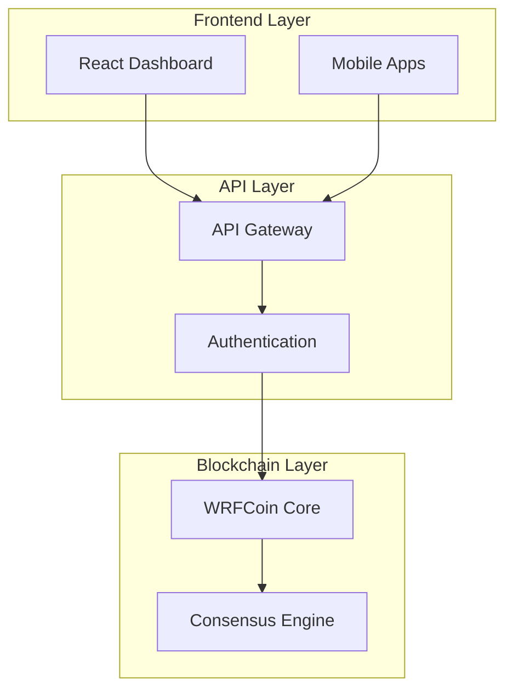

# WRFCoin Platform Documentation Style Guide

This style guide ensures consistency, clarity, and professionalism across all WRFCoin platform
documentation. It combines best practices from leading technology companies with platform-specific
requirements.

## Table of Contents

1. [General Principles](#general-principles)
2. [Document Structure](#document-structure)
3. [Writing Style](#writing-style)
4. [Code Documentation](#code-documentation)
5. [API Documentation](#api-documentation)
6. [Architecture Documentation](#architecture-documentation)
7. [Formatting Guidelines](#formatting-guidelines)
8. [Visual Elements](#visual-elements)
9. [Accessibility](#accessibility)
10. [Review Process](#review-process)

## General Principles

### 1. User-Centered Approach

- Write for your audience: developers, enterprise users, and community contributors
- Prioritize clarity and actionability over technical jargon
- Provide context before diving into implementation details

### 2. Consistency

- Use standardized terminology throughout all documentation
- Follow consistent formatting patterns
- Maintain uniform code style across examples

### 3. Accuracy

- Keep documentation synchronized with code changes
- Test all code examples before publishing
- Regularly review and update outdated information

### 4. Completeness

- Cover the full user journey from setup to advanced usage
- Include both success and error scenarios
- Provide troubleshooting guidance

## Document Structure

### Standard Document Template

Every documentation page should follow this structure:

```markdown
# [Page Title]

Brief overview (1-2 sentences) explaining what this page covers.

## Overview

Comprehensive introduction to the topic, including:

- What it is
- Why it's important
- When to use it

## Prerequisites

- List required knowledge/setup
- Link to prerequisite documentation
- Specify version requirements

## Quick Start

Step-by-step instructions for immediate success:

1. First step with expected output
2. Second step with verification
3. Next steps or references

## Detailed Guide

Comprehensive coverage of the topic with examples.

## Examples

Real-world usage scenarios with complete, working code.

## API Reference

(If applicable) Complete parameter and return value documentation.

## Troubleshooting

Common issues and their solutions.

## Related Resources

- Links to related documentation
- External references
- Community resources

## Changelog

- Version history
- Breaking changes
- Migration guides
```

### Heading Hierarchy

Use heading levels consistently:

- **H1 (#)**: Page title only (one per page)
- **H2 (##)**: Major sections
- **H3 (###)**: Subsections
- **H4 (####)**: Sub-subsections (use sparingly)
- **H5-H6**: Avoid unless absolutely necessary

## Writing Style

### Voice and Tone

**Active Voice**: Use active voice for clarity and directness.

- ✅ "Configure the API key"
- ❌ "The API key should be configured"

**Present Tense**: Use present tense for describing current functionality.

- ✅ "The function returns a promise"
- ❌ "The function will return a promise"

**Second Person**: Address the reader directly.

- ✅ "You can customize the settings"
- ❌ "One can customize the settings"

### Terminology Standards

#### WRFCoin-Specific Terms

| Term               | Usage                         | Avoid                  |
| ------------------ | ----------------------------- | ---------------------- |
| WRFCoin platform   | The complete ecosystem        | WRF, Wrfcoin, WRF-Coin |
| Computational NFT  | Our unique NFT implementation | Comp-NFT, cNFT         |
| Weather Oracle     | Data source integration       | Weather API, Data Feed |
| Cross-chain bridge | Inter-blockchain connectivity | Bridge, X-chain        |
| DAO governance     | Decentralized decision-making | Governance, DAO        |
| HSM integration    | Hardware security module      | HSM, Security module   |

#### Technical Terms

- **API**: Always uppercase, no periods (not "A.P.I.")
- **JSON**: Always uppercase
- **URL**: Always uppercase (not "url" or "Url")
- **HTTP/HTTPS**: Always uppercase
- **SDK**: Always uppercase
- **CLI**: Always uppercase
- **npm**: Always lowercase
- **Node.js**: Always with capital N and period

### Language Guidelines

**Be Concise**: Remove unnecessary words without losing meaning.

- ✅ "Click Save"
- ❌ "Click on the Save button"

**Use Specific Verbs**: Choose precise action words.

- ✅ "Configure, implement, deploy"
- ❌ "Set up, do, make"

**Avoid Ambiguity**: Be specific about quantities and conditions.

- ✅ "After 30 seconds"
- ❌ "After a while"

**Use Parallel Structure**: Maintain consistency in lists.

- ✅ "Install, configure, and deploy"
- ❌ "Install, configuration, and deploy"

## Code Documentation

### Code Blocks

Always specify the language for syntax highlighting:

```typescript
// ✅ Good: Language specified
const config: WRFCoinConfig = {
  apiKey: process.env.WRFCOIN_API_KEY,
  environment: 'production',
};
```

### Inline Code

Use backticks for:

- Function names: `authenticate()`
- Variable names: `apiKey`
- File names: `config.json`
- Command-line tools: `npm`
- HTTP methods: `GET`, `POST`

### Code Examples

**Complete and Runnable**: All code examples should be complete and functional.

```typescript
// ✅ Complete example
import { WRFCoinSDK } from '@wrfcoin/sdk';

const sdk = new WRFCoinSDK({
  apiKey: 'your-api-key',
  environment: 'production',
});

async function getWeatherData() {
  try {
    const data = await sdk.weather.getCurrentData('tokyo');
    console.log('Weather data:', data);
    return data;
  } catch (error) {
    console.error('Error fetching weather data:', error);
    throw error;
  }
}
```

**Include Error Handling**: Show how to handle common errors.

**Use Realistic Examples**: Use meaningful variable names and realistic data.

### Comments in Code

- Use comments to explain "why," not "what"
- Keep comments up-to-date with code changes
- Use TypeScript types instead of comments when possible

```typescript
// ✅ Good: Explains why
// Retry failed requests to handle temporary network issues
const retryConfig = { retries: 3, backoff: 'exponential' };

// ❌ Bad: Explains what (obvious from code)
// Set retries to 3
const retryConfig = { retries: 3 };
```

## API Documentation

### Endpoint Documentation

Use consistent formatting for API endpoints:

````markdown
### POST /api/v1/weather/forecast

Create a new weather forecast computation.

#### Request

**Headers:**

- `Authorization`: Bearer token (required)
- `Content-Type`: application/json

**Body:**

```json
{
  "location": {
    "latitude": 35.6762,
    "longitude": 139.6503
  },
  "modelType": "GFS",
  "duration": "7d"
}
```
````

**Parameters:**

- `location` (object, required): Geographic coordinates
  - `latitude` (number): Latitude in decimal degrees
  - `longitude` (number): Longitude in decimal degrees
- `modelType` (string, required): Weather model type
  - Allowed values: `"GFS"`, `"ECMWF"`, `"NAM"`
- `duration` (string, required): Forecast duration
  - Format: `{number}{unit}` where unit is `d`, `h`, or `m`

#### Response

**Success (201 Created):**

```json
{
  "id": "forecast_123456",
  "status": "queued",
  "estimatedCompletion": "2025-01-15T14:30:00Z",
  "computationCost": "0.05 WRF"
}
```

**Error (400 Bad Request):**

```json
{
  "error": "INVALID_LOCATION",
  "message": "Latitude must be between -90 and 90 degrees",
  "details": {
    "field": "location.latitude",
    "provided": 95.0,
    "expected": "number between -90 and 90"
  }
}
```

````

### Status Codes

Document all possible HTTP status codes:

- **200 OK**: Successful request
- **201 Created**: Resource created successfully
- **400 Bad Request**: Invalid request parameters
- **401 Unauthorized**: Authentication required
- **403 Forbidden**: Insufficient permissions
- **404 Not Found**: Resource not found
- **429 Too Many Requests**: Rate limit exceeded
- **500 Internal Server Error**: Server error

## Architecture Documentation

### Architecture Decision Records (ADRs)

Use this template for ADRs:

```markdown
# ADR-001: [Brief Title]

## Status
[Proposed | Accepted | Superseded by ADR-XXX]

## Context
Describe the situation that led to this decision.

## Decision
State the decision clearly.

## Rationale
Explain why this decision was made.

## Consequences
- **Positive**: Benefits of this decision
- **Negative**: Drawbacks or risks
- **Neutral**: Other implications

## Alternatives Considered
List other options that were evaluated.

## Related Decisions
- ADR-XXX: Related decision
- RFC-XXX: Related proposal
````

### System Diagrams

Use Mermaid for system diagrams:



Include captions and explanations for complex diagrams.

## Formatting Guidelines

### Lists

**Ordered Lists**: Use for sequential steps or prioritized items.

1. First step
2. Second step
3. Third step

**Unordered Lists**: Use for non-sequential items.

- Feature A
- Feature B
- Feature C

**Nested Lists**: Use consistent indentation (2 spaces).

1. Main item
   - Sub-item
   - Sub-item
2. Main item
   - Sub-item

### Tables

Use tables for structured data comparison:

| Feature   | Free Tier   | Pro Tier      | Enterprise |
| --------- | ----------- | ------------- | ---------- |
| API Calls | 1,000/month | 100,000/month | Unlimited  |
| Storage   | 1 GB        | 100 GB        | Unlimited  |
| Support   | Community   | Email         | 24/7 Phone |

**Table Guidelines:**

- Include headers for all columns
- Keep content concise
- Use consistent formatting
- Consider mobile responsiveness

### Links

**Internal Links**: Use relative paths for internal documentation.

- ✅ `[API Reference](../api/reference.md)`
- ❌ `[API Reference](https://docs.wrfcoin.com/api/reference.md)`

**External Links**: Use full URLs and open in new tabs when appropriate.

- ✅ `[TypeScript Handbook](https://www.typescriptlang.org/docs/)`

**Link Text**: Use descriptive text, avoid "click here."

- ✅ `[WRFCoin SDK documentation](./sdk/README.md)`
- ❌ `[Click here](./sdk/README.md) for SDK docs`

### Emphasis

**Bold**: Use for UI elements and important terms.

- ✅ Click the **Save** button
- ✅ The **WRFCoin platform** provides...

**Italic**: Use for emphasis and new terms.

- ✅ The _computational NFT_ concept...
- ✅ This is _especially important_ when...

**Code**: Use for technical terms and values.

- ✅ Set `NODE_ENV` to `production`

## Visual Elements

### Screenshots

**Requirements:**

- Use consistent browser/OS for screenshots
- Highlight relevant UI elements
- Include alt text for accessibility
- Optimize file size (PNG for UI, JPG for photos)

**Naming Convention:**

```
screenshot-[feature]-[action]-[date].png
Example: screenshot-dashboard-weather-data-20250122.png
```

### Diagrams

**Tools to Use:**

- Mermaid for flowcharts and system diagrams
- Draw.io for complex architectural diagrams
- PlantUML for UML diagrams

**Guidelines:**

- Use consistent colors and styling
- Include descriptive titles
- Provide alternative text descriptions
- Keep diagrams simple and focused

### Code Syntax Highlighting

Support these languages in code blocks:

- `typescript` / `ts`
- `javascript` / `js`
- `json`
- `bash` / `shell`
- `sql`
- `yaml`
- `toml`
- `rust`
- `solidity`
- `python`
- `go`

## Accessibility

### Text Alternatives

- Provide alt text for all images
- Include text descriptions for complex diagrams
- Use descriptive link text

### Structure

- Use proper heading hierarchy
- Include table headers
- Use semantic HTML when applicable

### Color and Contrast

- Don't rely solely on color to convey information
- Ensure sufficient contrast ratios
- Test with colorblind-friendly palettes

## Review Process

### Documentation Review Checklist

Before publishing documentation:

**Content Review:**

- [ ] Information is accurate and up-to-date
- [ ] All code examples are tested and functional
- [ ] Links are valid and point to correct resources
- [ ] Terminology follows the style guide
- [ ] Structure follows the standard template

**Technical Review:**

- [ ] Code examples follow best practices
- [ ] Security considerations are addressed
- [ ] Performance implications are noted
- [ ] Error handling is demonstrated

**Editorial Review:**

- [ ] Grammar and spelling are correct
- [ ] Tone and voice are consistent
- [ ] Reading level is appropriate for audience
- [ ] Content flows logically

**Accessibility Review:**

- [ ] Alt text provided for images
- [ ] Proper heading structure used
- [ ] Content is screen reader friendly
- [ ] Color is not the only means of conveying information

### Review Workflow

1. **Author**: Creates initial documentation
2. **Technical Review**: Subject matter expert reviews accuracy
3. **Editorial Review**: Editor reviews style and clarity
4. **Accessibility Review**: Accessibility expert reviews compliance
5. **Final Approval**: Documentation team lead approves for publication

### Maintenance

**Regular Reviews:**

- Quarterly review of all documentation
- Update with each major release
- Monitor user feedback and questions
- Track analytics for popular content

**Version Control:**

- Use Git for all documentation changes
- Include meaningful commit messages
- Tag documentation versions with releases
- Maintain changelog for major updates

## Tools and Templates

### Recommended Tools

**Writing:**

- VS Code with Markdown extensions
- Grammarly for grammar checking
- Hemingway Editor for readability

**Diagrams:**

- Mermaid for flowcharts
- Draw.io for complex diagrams
- PlantUML for UML diagrams

**Screenshots:**

- Chrome DevTools for consistent browser screenshots
- Annotate.app for macOS annotations
- Greenshot for Windows annotations

### Templates

### Quick Start Template

````markdown
# Quick Start: [Feature Name]

Get started with [feature] in under 5 minutes.

## Before You Begin

- [ ] Prerequisite 1
- [ ] Prerequisite 2

## Step 1: [Action]

```bash
command-to-run
```
````

Expected output:

```
expected output here
```

## Step 2: [Next Action]

[Instructions...]

## Verify Your Setup

[How to confirm everything works]

## Next Steps

- [Link to detailed guide]
- [Link to examples]
- [Link to API reference]

````

### Tutorial Template
```markdown
# Tutorial: [Tutorial Name]

In this tutorial, you'll learn how to [specific learning objective].

**Time to Complete**: X minutes
**Difficulty**: Beginner/Intermediate/Advanced

## What You'll Learn
- Specific skill 1
- Specific skill 2
- Specific skill 3

## Before You Begin
[Prerequisites and setup]

## Overview
[Brief explanation of what we'll build]

## Step 1: [First Step]
[Detailed instructions with code examples]

### Explanation
[Why this step is important]

## Step 2: [Second Step]
[Continue with clear progression]

## Testing Your Implementation
[How to verify it works]

## Troubleshooting
[Common issues and solutions]

## Summary
[Recap of what was accomplished]

## Next Steps
[Where to go from here]
````

---

## Conclusion

This style guide is a living document that evolves with the WRFCoin platform. All contributors
should familiarize themselves with these guidelines to maintain consistency and quality across our
documentation ecosystem.

For questions or suggestions about this style guide, please:

- Open an issue in the documentation repository
- Contact the documentation team
- Discuss in the #documentation Discord channel

**Last Updated**: January 22, 2025 **Version**: 1.0.0
