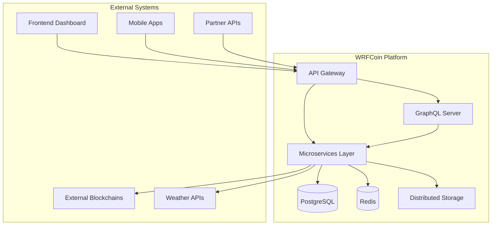

# WRFCoin API & Backend Integration Architecture

## Executive Summary

This document defines the comprehensive API & backend integration architecture for the WRFCoin
weather forecasting blockchain platform. The architecture supports 15+ microservices, GraphQL
integration, cross-chain protocols, and enterprise-grade performance requirements.

## Architecture Overview

### System Context (C4 Level 1)



### Container Architecture (C4 Level 2)

The WRFCoin platform consists of the following primary containers:

#### Core API Layer

- **Main API Server** (Port 4001) - Primary application endpoints
- **GraphQL Server** (Port 4000) - Unified GraphQL interface
- **Cross-Chain Server** (Port 3000) - Multi-blockchain bridges
- **Wallet Server** (Port 4000) - BIP-39/44 wallet operations

#### Specialized Services

- **Compute Networks** (Port 6000) - Distributed computing and AI/ML
- **AI/ML Networks** (Port 6001) - Machine learning model deployment
- **Storage Networks** (Port 7000) - IPFS, Filecoin, Arweave integration
- **IoT Sensor Networks** (Port 3002) - Environmental sensor management
- **Weather Earnings** (Port 8080) - Weather station reward distribution
- **Governance Server** (Port 8000) - DAO proposals and voting
- **Node Discovery** (Port 9001) - P2P network coordination

#### Data Layer

- **PostgreSQL** (Port 5432) - Consolidated 21-table schema
- **Redis** (Port 6379) - Caching and session management
- **Distributed Storage** - IPFS/Filecoin/Arweave

## Service Communication Architecture

### Communication Protocols

#### 1. Inter-Service Communication Standards

```typescript
// Service Registry Pattern
interface ServiceEndpoint {
  host: string;
  port: number;
  protocol: 'http' | 'https' | 'grpc';
  healthCheck: string;
  timeout: number;
  retries: number;
}

const SERVICE_REGISTRY: Record<string, ServiceEndpoint> = {
  mainApi: {
    host: 'localhost',
    port: 4001,
    protocol: 'http',
    healthCheck: '/health',
    timeout: 5000,
    retries: 3,
  },
  graphql: {
    host: 'localhost',
    port: 4000,
    protocol: 'http',
    healthCheck: '/health',
    timeout: 10000,
    retries: 2,
  },
  crossChain: {
    host: 'localhost',
    port: 3000,
    protocol: 'http',
    healthCheck: '/health',
    timeout: 15000,
    retries: 3,
  },
  compute: {
    host: 'localhost',
    port: 6000,
    protocol: 'http',
    healthCheck: '/health',
    timeout: 30000,
    retries: 2,
  },
  aiml: {
    host: 'localhost',
    port: 6001,
    protocol: 'http',
    healthCheck: '/health',
    timeout: 45000,
    retries: 2,
  },
  storage: {
    host: 'localhost',
    port: 7000,
    protocol: 'http',
    healthCheck: '/health',
    timeout: 20000,
    retries: 3,
  },
  iot: {
    host: 'localhost',
    port: 3002,
    protocol: 'http',
    healthCheck: '/health',
    timeout: 10000,
    retries: 3,
  },
  governance: {
    host: 'localhost',
    port: 8000,
    protocol: 'http',
    healthCheck: '/health',
    timeout: 15000,
    retries: 2,
  },
  weatherEarnings: {
    host: 'localhost',
    port: 8080,
    protocol: 'http',
    healthCheck: '/health',
    timeout: 10000,
    retries: 3,
  },
  nodeDiscovery: {
    host: 'localhost',
    port: 9001,
    protocol: 'http',
    healthCheck: '/health',
    timeout: 5000,
    retries: 2,
  },
};
```

#### 2. Request/Response Patterns

```typescript
// Standardized API Response Format
interface ApiResponse<T = any> {
  success: boolean;
  data?: T;
  error?: {
    code: string;
    message: string;
    details?: any;
  };
  metadata: {
    requestId: string;
    timestamp: string;
    latency: number;
    service: string;
  };
}

// Service Client Implementation
class ServiceClient {
  private baseURL: string;
  private timeout: number;
  private retries: number;
  private circuitBreaker: ServiceCircuitBreaker;

  constructor(serviceName: string) {
    const serviceConfig = SERVICE_REGISTRY[serviceName];
    this.baseURL = `${serviceConfig.protocol}://${serviceConfig.host}:${serviceConfig.port}`;
    this.timeout = serviceConfig.timeout;
    this.retries = serviceConfig.retries;
    this.circuitBreaker = new ServiceCircuitBreaker(serviceName);
  }

  async request<T>(endpoint: string, options: RequestOptions = {}): Promise<ApiResponse<T>> {
    const requestId = generateRequestId();
    const startTime = Date.now();

    try {
      const response = await this.circuitBreaker.execute(() =>
        this.executeWithRetry(() => this.makeRequest(endpoint, options, requestId), this.retries)
      );

      return {
        success: true,
        data: response.data,
        metadata: {
          requestId,
          timestamp: new Date().toISOString(),
          latency: Date.now() - startTime,
          service: this.serviceName,
        },
      };
    } catch (error) {
      return this.handleError(error, requestId, startTime);
    }
  }

  private async executeWithRetry<T>(
    operation: () => Promise<T>,
    retries: number,
    delay: number = 1000
  ): Promise<T> {
    let lastError: Error;

    for (let i = 0; i <= retries; i++) {
      try {
        return await operation();
      } catch (error) {
        lastError = error as Error;

        if (i < retries) {
          await new Promise(resolve => setTimeout(resolve, delay * Math.pow(2, i)));
        }
      }
    }

    throw lastError!;
  }
}
```

### GraphQL Integration Patterns

#### 1. Resolver-to-Service Integration

```typescript
// Enhanced Token Resolver with Service Integration
export const tokenResolvers = {
  Query: {
    wrfToken: withPerformanceMonitoring(
      'wrfToken',
      async (_: any, __: any, context: GraphQLContext) => {
        const { services } = context;

        try {
          // Parallel service calls with circuit breaker pattern
          const [tokenData, stationData, governanceData] = await Promise.allSettled([
            services.blockchain.getTokenInfo(),
            services.weather.getWeatherStations({ limit: 20, active: true }),
            services.governance.getGovernanceStats(),
          ]);

          // Extract successful data with fallbacks
          const token = extractSuccessfulData(tokenData, {});
          const stations = extractSuccessfulData(stationData, []);
          const governance = extractSuccessfulData(governanceData, {});

          return {
            ...token,
            weatherStations: stations.map(station => ({
              id: station.stationId,
              address: station.ownerAddress,
              location: station.location,
              isActive: station.isActive,
              totalRewards: station.totalRewards || '0',
              qualityScore: station.qualityScore || 0,
              lastRewardTime: station.lastRewardTime?.toISOString(),
            })),
            governanceStats: {
              totalProposals: governance.totalProposals || 0,
              activeProposals: governance.activeProposals || 0,
              totalVotes: governance.totalVotes || 0,
              participationRate: governance.participationRate || 0,
            },
          };
        } catch (error) {
          const errorContext = {
            requestId: context.requestId,
            operationType: 'wrfToken',
            clientIP: context.clientIP,
          };

          logger.error('Error in wrfToken resolver', {
            error: error instanceof Error ? error.message : String(error),
            ...errorContext,
          });

          throw formatError(error, errorContext);
        }
      }
    ),
  },
};

// Service Context Injection
interface GraphQLContext {
  requestId: string;
  user?: User;
  db: DatabaseConnection;
  services: {
    blockchain: BlockchainService;
    weather: WeatherService;
    governance: GovernanceService;
    crossChain: CrossChainService;
    compute: ComputeService;
    storage: StorageService;
    iot: IoTService;
  };
  cache: CacheService;
  logger: Logger;
  clientIP: string;
  userAgent?: string;
}

// Service Context Factory
export function createServiceContext(): GraphQLContext['services'] {
  return {
    blockchain: new ServiceClient('mainApi'),
    weather: new ServiceClient('iot'),
    governance: new ServiceClient('governance'),
    crossChain: new ServiceClient('crossChain'),
    compute: new ServiceClient('compute'),
    storage: new ServiceClient('storage'),
    iot: new ServiceClient('iot'),
  };
}
```

#### 2. Data Loader Pattern for Performance

```typescript
// Batch Loading for Related Data
class ServiceDataLoader {
  private tokenLoader = new DataLoader(
    async (tokenIds: string[]) => {
      const tokens = await this.services.blockchain.getTokensBatch(tokenIds);
      return tokenIds.map(id => tokens.find(t => t.id === id));
    },
    {
      maxBatchSize: 100,
      cacheKeyFn: key => `token:${key}`,
      cacheMap: new Map(),
    }
  );

  private stationLoader = new DataLoader(
    async (stationIds: string[]) => {
      const stations = await this.services.weather.getStationsBatch(stationIds);
      return stationIds.map(id => stations.find(s => s.id === id));
    },
    {
      maxBatchSize: 50,
      cacheKeyFn: key => `station:${key}`,
      cacheMap: new Map(),
    }
  );

  private proposalLoader = new DataLoader(
    async (proposalIds: string[]) => {
      const proposals = await this.services.governance.getProposalsBatch(proposalIds);
      return proposalIds.map(id => proposals.find(p => p.id === id));
    },
    {
      maxBatchSize: 20,
      cacheKeyFn: key => `proposal:${key}`,
      cacheMap: new Map(),
    }
  );

  async loadToken(id: string) {
    return this.tokenLoader.load(id);
  }

  async loadStation(id: string) {
    return this.stationLoader.load(id);
  }

  async loadProposal(id: string) {
    return this.proposalLoader.load(id);
  }

  // Clear cache for specific entities
  clearToken(id: string) {
    this.tokenLoader.clear(id);
  }

  clearStation(id: string) {
    this.stationLoader.clear(id);
  }

  clearProposal(id: string) {
    this.proposalLoader.clear(id);
  }
}
```

## Data Flow Architecture

### Database Integration Patterns

#### 1. Consolidated Schema Access

```typescript
// Database Service Layer
class DatabaseService {
  private pool: Pool;
  private redis: Redis;
  private queryCache = new Map<string, any>();

  constructor() {
    this.pool = new Pool({
      host: process.env.DB_HOST,
      port: parseInt(process.env.DB_PORT || '5432'),
      database: process.env.DB_NAME,
      user: process.env.DB_USER,
      password: process.env.DB_PASSWORD,
      max: 50,
      min: 5,
      idleTimeoutMillis: 30000,
      connectionTimeoutMillis: 5000,
      acquireTimeoutMillis: 10000,
      statement_timeout: '30s',
      query_timeout: '25s',
    });

    this.redis = new Redis({
      host: process.env.REDIS_HOST,
      port: parseInt(process.env.REDIS_PORT || '6379'),
      maxRetriesPerRequest: 3,
      retryDelayOnFailover: 100,
      connectTimeout: 10000,
      commandTimeout: 5000,
    });
  }

  // Unified query interface with caching
  async query<T>(sql: string, params: any[] = [], options: QueryOptions = {}): Promise<T[]> {
    const queryHash = this.generateQueryHash(sql, params);

    // Check in-memory cache first (L1)
    if (options.useMemoryCache && this.queryCache.has(queryHash)) {
      const cached = this.queryCache.get(queryHash);
      if (Date.now() - cached.timestamp < (options.memoryCacheTTL || 60000)) {
        return cached.data;
      }
    }

    // Check Redis cache (L2)
    const cacheKey = options.cache ? this.generateCacheKey(sql, params) : null;
    if (cacheKey) {
      const cached = await this.redis.get(cacheKey);
      if (cached) {
        const data = JSON.parse(cached);

        // Store in memory cache for faster subsequent access
        if (options.useMemoryCache) {
          this.queryCache.set(queryHash, {
            data,
            timestamp: Date.now(),
          });
        }

        return data;
      }
    }

    // Execute query against database (L3)
    const startTime = Date.now();
    const result = await this.pool.query(sql, params);
    const queryTime = Date.now() - startTime;

    // Log slow queries
    if (queryTime > 1000) {
      logger.warn('Slow query detected', {
        sql: sql.substring(0, 200),
        params: params.slice(0, 5),
        duration: queryTime,
      });
    }

    // Cache results
    if (cacheKey && options.cacheTTL) {
      await this.redis.setex(cacheKey, options.cacheTTL, JSON.stringify(result.rows));
    }

    if (options.useMemoryCache) {
      this.queryCache.set(queryHash, {
        data: result.rows,
        timestamp: Date.now(),
      });
    }

    return result.rows;
  }

  // Transaction management
  async transaction<T>(callback: (client: PoolClient) => Promise<T>): Promise<T> {
    const client = await this.pool.connect();
    const transactionId = generateTransactionId();

    try {
      logger.debug('Starting transaction', { transactionId });
      await client.query('BEGIN');

      const result = await callback(client);

      await client.query('COMMIT');
      logger.debug('Transaction committed', { transactionId });

      return result;
    } catch (error) {
      logger.error('Transaction failed, rolling back', {
        transactionId,
        error: error instanceof Error ? error.message : String(error),
      });

      await client.query('ROLLBACK');
      throw error;
    } finally {
      client.release();
    }
  }

  private generateCacheKey(sql: string, params: any[]): string {
    const hash = crypto
      .createHash('md5')
      .update(sql + JSON.stringify(params))
      .digest('hex');
    return `query:${hash}`;
  }

  private generateQueryHash(sql: string, params: any[]): string {
    return crypto
      .createHash('sha256')
      .update(sql + JSON.stringify(params))
      .digest('hex');
  }
}

interface QueryOptions {
  cache?: boolean;
  cacheTTL?: number;
  useMemoryCache?: boolean;
  memoryCacheTTL?: number;
  timeout?: number;
}
```

#### 2. Caching Strategy

```typescript
// Multi-Level Caching Architecture
interface CacheStrategy {
  // L1: In-memory application cache
  memory: {
    ttl: number;
    maxSize: number;
    evictionPolicy: 'LRU' | 'LFU' | 'FIFO';
  };

  // L2: Redis distributed cache
  redis: {
    ttl: number;
    keyPattern: string;
    compressionEnabled: boolean;
  };

  // L3: Database query optimization
  database: {
    indexStrategy: string[];
    partitioning?: string;
    queryHints?: string[];
  };
}

const CACHE_STRATEGIES: Record<string, CacheStrategy> = {
  weatherData: {
    memory: { ttl: 300, maxSize: 1000, evictionPolicy: 'LRU' },
    redis: { ttl: 900, keyPattern: 'weather:{stationId}:{timestamp}', compressionEnabled: true },
    database: {
      indexStrategy: ['station_id', 'timestamp', 'location'],
      partitioning: 'RANGE(timestamp)',
      queryHints: ['USE INDEX (idx_station_timestamp)'],
    },
  },
  tokenPrices: {
    memory: { ttl: 60, maxSize: 100, evictionPolicy: 'LFU' },
    redis: { ttl: 300, keyPattern: 'price:{tokenId}:{interval}', compressionEnabled: false },
    database: {
      indexStrategy: ['token_id', 'timestamp'],
      queryHints: ['FORCE INDEX (idx_token_timestamp)'],
    },
  },
  userProfiles: {
    memory: { ttl: 600, maxSize: 500, evictionPolicy: 'LRU' },
    redis: { ttl: 1800, keyPattern: 'user:{address}', compressionEnabled: true },
    database: {
      indexStrategy: ['address', 'created_at', 'last_activity'],
      queryHints: ['USE INDEX (idx_user_address)'],
    },
  },
  governanceProposals: {
    memory: { ttl: 180, maxSize: 200, evictionPolicy: 'LRU' },
    redis: { ttl: 600, keyPattern: 'proposal:{proposalId}', compressionEnabled: true },
    database: {
      indexStrategy: ['proposal_id', 'state', 'created_at'],
      queryHints: ['USE INDEX (idx_proposal_state_created)'],
    },
  },
  crossChainBridges: {
    memory: { ttl: 120, maxSize: 150, evictionPolicy: 'LFU' },
    redis: {
      ttl: 300,
      keyPattern: 'bridge:{sourceChain}:{destChain}:{txHash}',
      compressionEnabled: true,
    },
    database: {
      indexStrategy: ['transaction_hash', 'source_chain', 'destination_chain', 'status'],
      queryHints: ['USE INDEX (idx_bridge_status_chains)'],
    },
  },
};

// Cache Manager Implementation
class CacheManager {
  private memoryCache = new Map<string, CacheEntry>();
  private redis: Redis;
  private cacheStats = new Map<string, CacheStats>();

  constructor(redis: Redis) {
    this.redis = redis;

    // Periodic cleanup of expired memory cache entries
    setInterval(() => this.cleanupMemoryCache(), 60000);
  }

  async get<T>(key: string, strategy: CacheStrategy): Promise<T | null> {
    const startTime = Date.now();

    try {
      // L1: Check memory cache
      const memoryEntry = this.memoryCache.get(key);
      if (memoryEntry && Date.now() - memoryEntry.timestamp < strategy.memory.ttl * 1000) {
        this.updateCacheStats(key, 'memory_hit', Date.now() - startTime);
        return memoryEntry.data;
      }

      // L2: Check Redis cache
      const redisValue = await this.redis.get(key);
      if (redisValue) {
        const data = strategy.redis.compressionEnabled
          ? this.decompress(redisValue)
          : JSON.parse(redisValue);

        // Store in memory cache for next access
        this.setMemoryCache(key, data, strategy);

        this.updateCacheStats(key, 'redis_hit', Date.now() - startTime);
        return data;
      }

      this.updateCacheStats(key, 'miss', Date.now() - startTime);
      return null;
    } catch (error) {
      logger.error('Cache get error', {
        key,
        error: error instanceof Error ? error.message : String(error),
      });
      return null;
    }
  }

  async set<T>(key: string, value: T, strategy: CacheStrategy): Promise<void> {
    try {
      // Set in memory cache
      this.setMemoryCache(key, value, strategy);

      // Set in Redis cache
      const serializedValue = strategy.redis.compressionEnabled
        ? this.compress(JSON.stringify(value))
        : JSON.stringify(value);

      await this.redis.setex(key, strategy.redis.ttl, serializedValue);
    } catch (error) {
      logger.error('Cache set error', {
        key,
        error: error instanceof Error ? error.message : String(error),
      });
    }
  }

  private setMemoryCache<T>(key: string, value: T, strategy: CacheStrategy): void {
    // Implement LRU eviction if cache is full
    if (this.memoryCache.size >= strategy.memory.maxSize) {
      this.evictMemoryCache(strategy.memory.evictionPolicy);
    }

    this.memoryCache.set(key, {
      data: value,
      timestamp: Date.now(),
      accessCount: 1,
    });
  }

  private evictMemoryCache(policy: 'LRU' | 'LFU' | 'FIFO'): void {
    if (this.memoryCache.size === 0) return;

    let keyToEvict: string;

    switch (policy) {
      case 'LRU':
        keyToEvict = [...this.memoryCache.entries()].sort(
          ([, a], [, b]) => a.timestamp - b.timestamp
        )[0][0];
        break;
      case 'LFU':
        keyToEvict = [...this.memoryCache.entries()].sort(
          ([, a], [, b]) => a.accessCount - b.accessCount
        )[0][0];
        break;
      case 'FIFO':
      default:
        keyToEvict = this.memoryCache.keys().next().value;
        break;
    }

    this.memoryCache.delete(keyToEvict);
  }

  private cleanupMemoryCache(): void {
    const now = Date.now();
    const keysToDelete: string[] = [];

    for (const [key, entry] of this.memoryCache.entries()) {
      // Remove entries older than 1 hour regardless of TTL
      if (now - entry.timestamp > 3600000) {
        keysToDelete.push(key);
      }
    }

    keysToDelete.forEach(key => this.memoryCache.delete(key));

    if (keysToDelete.length > 0) {
      logger.debug('Cleaned up memory cache', { removedKeys: keysToDelete.length });
    }
  }

  private updateCacheStats(
    key: string,
    type: 'memory_hit' | 'redis_hit' | 'miss',
    latency: number
  ): void {
    const stats = this.cacheStats.get(key) || {
      memoryHits: 0,
      redisHits: 0,
      misses: 0,
      totalLatency: 0,
      callCount: 0,
    };

    stats.callCount++;
    stats.totalLatency += latency;

    switch (type) {
      case 'memory_hit':
        stats.memoryHits++;
        break;
      case 'redis_hit':
        stats.redisHits++;
        break;
      case 'miss':
        stats.misses++;
        break;
    }

    this.cacheStats.set(key, stats);
  }

  private compress(data: string): string {
    // Implement compression logic (e.g., using zlib)
    return data; // Placeholder
  }

  private decompress(data: string): any {
    // Implement decompression logic
    return JSON.parse(data); // Placeholder
  }

  getCacheStats(): Map<string, CacheStats> {
    return new Map(this.cacheStats);
  }
}

interface CacheEntry {
  data: any;
  timestamp: number;
  accessCount: number;
}

interface CacheStats {
  memoryHits: number;
  redisHits: number;
  misses: number;
  totalLatency: number;
  callCount: number;
}
```

## Error Handling Architecture

### Centralized Error Management

```typescript
// Error Classification and Handling
enum ErrorCategory {
  VALIDATION = 'VALIDATION',
  AUTHENTICATION = 'AUTHENTICATION',
  AUTHORIZATION = 'AUTHORIZATION',
  BLOCKCHAIN = 'BLOCKCHAIN',
  DATABASE = 'DATABASE',
  NETWORK = 'NETWORK',
  BUSINESS_LOGIC = 'BUSINESS_LOGIC',
  SYSTEM = 'SYSTEM',
  EXTERNAL_SERVICE = 'EXTERNAL_SERVICE',
  RATE_LIMIT = 'RATE_LIMIT',
  TIMEOUT = 'TIMEOUT',
}

enum ErrorSeverity {
  LOW = 'LOW',
  MEDIUM = 'MEDIUM',
  HIGH = 'HIGH',
  CRITICAL = 'CRITICAL',
}

interface ErrorContext {
  requestId: string;
  service: string;
  operation: string;
  userId?: string;
  clientIP: string;
  userAgent?: string;
  timestamp: string;
  correlationId?: string;
  stackTrace?: string;
}

class WrfcoinError extends Error {
  constructor(
    public code: string,
    public category: ErrorCategory,
    public severity: ErrorSeverity,
    message: string,
    public context: ErrorContext,
    public retryable: boolean = false,
    public cause?: Error
  ) {
    super(message);
    this.name = 'WrfcoinError';

    if (cause) {
      this.stack = `${this.stack}\nCaused by: ${cause.stack}`;
    }
  }

  toJSON() {
    return {
      name: this.name,
      code: this.code,
      category: this.category,
      severity: this.severity,
      message: this.message,
      context: this.context,
      retryable: this.retryable,
      timestamp: new Date().toISOString(),
    };
  }
}

// Error Handler with Circuit Breaker
class ErrorHandler {
  private circuitBreakers = new Map<string, ServiceCircuitBreaker>();
  private errorCounters = new Map<string, number>();
  private alertThresholds = new Map<ErrorCategory, number>();

  constructor() {
    // Set alert thresholds for different error categories
    this.alertThresholds.set(ErrorCategory.CRITICAL, 1);
    this.alertThresholds.set(ErrorCategory.HIGH, 5);
    this.alertThresholds.set(ErrorCategory.MEDIUM, 20);
    this.alertThresholds.set(ErrorCategory.LOW, 50);
  }

  async handleError(error: Error, context: ErrorContext): Promise<never> {
    const wrfError = this.classifyError(error, context);

    // Update error counters
    this.updateErrorCounters(wrfError);

    // Log error with appropriate level
    this.logError(wrfError);

    // Circuit breaker logic for external services
    if (
      wrfError.category === ErrorCategory.NETWORK ||
      wrfError.category === ErrorCategory.EXTERNAL_SERVICE
    ) {
      this.updateCircuitBreaker(context.service, false);
    }

    // Error escalation for critical errors or threshold breaches
    if (this.shouldEscalate(wrfError)) {
      await this.escalateError(wrfError);
    }

    // Send metrics to monitoring systems
    await this.recordErrorMetrics(wrfError);

    throw wrfError;
  }

  private classifyError(error: Error, context: ErrorContext): WrfcoinError {
    if (error instanceof WrfcoinError) {
      return error;
    }

    // Classify error based on message and type
    let category = ErrorCategory.SYSTEM;
    let severity = ErrorSeverity.MEDIUM;
    let code = 'UNKNOWN_ERROR';
    let retryable = false;

    const errorMessage = error.message.toLowerCase();

    if (errorMessage.includes('validation') || errorMessage.includes('invalid input')) {
      category = ErrorCategory.VALIDATION;
      severity = ErrorSeverity.LOW;
      code = 'VALIDATION_ERROR';
      retryable = false;
    } else if (errorMessage.includes('unauthorized') || errorMessage.includes('authentication')) {
      category = ErrorCategory.AUTHENTICATION;
      severity = ErrorSeverity.MEDIUM;
      code = 'AUTH_ERROR';
      retryable = false;
    } else if (errorMessage.includes('permission') || errorMessage.includes('forbidden')) {
      category = ErrorCategory.AUTHORIZATION;
      severity = ErrorSeverity.MEDIUM;
      code = 'AUTHORIZATION_ERROR';
      retryable = false;
    } else if (errorMessage.includes('timeout')) {
      category = ErrorCategory.TIMEOUT;
      severity = ErrorSeverity.HIGH;
      code = 'TIMEOUT_ERROR';
      retryable = true;
    } else if (errorMessage.includes('rate limit')) {
      category = ErrorCategory.RATE_LIMIT;
      severity = ErrorSeverity.MEDIUM;
      code = 'RATE_LIMIT_ERROR';
      retryable = true;
    } else if (errorMessage.includes('database') || errorMessage.includes('sql')) {
      category = ErrorCategory.DATABASE;
      severity = ErrorSeverity.HIGH;
      code = 'DATABASE_ERROR';
      retryable = true;
    } else if (errorMessage.includes('network') || errorMessage.includes('connection')) {
      category = ErrorCategory.NETWORK;
      severity = ErrorSeverity.HIGH;
      code = 'NETWORK_ERROR';
      retryable = true;
    } else if (errorMessage.includes('blockchain') || errorMessage.includes('transaction')) {
      category = ErrorCategory.BLOCKCHAIN;
      severity = ErrorSeverity.HIGH;
      code = 'BLOCKCHAIN_ERROR';
      retryable = true;
    }

    return new WrfcoinError(code, category, severity, error.message, context, retryable, error);
  }

  private updateErrorCounters(error: WrfcoinError): void {
    const key = `${error.category}:${error.severity}`;
    const current = this.errorCounters.get(key) || 0;
    this.errorCounters.set(key, current + 1);
  }

  private shouldEscalate(error: WrfcoinError): boolean {
    if (error.severity === ErrorSeverity.CRITICAL) {
      return true;
    }

    const threshold = this.alertThresholds.get(error.category);
    if (!threshold) return false;

    const key = `${error.category}:${error.severity}`;
    const count = this.errorCounters.get(key) || 0;

    return count >= threshold;
  }

  private async escalateError(error: WrfcoinError): Promise<void> {
    // Send to monitoring systems
    const escalationPromises = [
      this.sendToSentry(error),
      this.sendToSlack(error),
      this.updateMetrics(error),
      this.notifyOnCall(error),
    ];

    await Promise.allSettled(escalationPromises);
  }

  private async sendToSentry(error: WrfcoinError): Promise<void> {
    try {
      // Sentry integration
      logger.info('Sending error to Sentry', { errorId: error.context.requestId });
    } catch (sentry_error) {
      logger.error('Failed to send to Sentry', { error: sentry_error });
    }
  }

  private async sendToSlack(error: WrfcoinError): Promise<void> {
    try {
      if (error.severity === ErrorSeverity.CRITICAL || error.severity === ErrorSeverity.HIGH) {
        // Slack webhook integration
        logger.info('Sending alert to Slack', { errorId: error.context.requestId });
      }
    } catch (slack_error) {
      logger.error('Failed to send to Slack', { error: slack_error });
    }
  }

  private async updateMetrics(error: WrfcoinError): Promise<void> {
    try {
      // Prometheus metrics update
      logger.info('Updating error metrics', {
        category: error.category,
        severity: error.severity,
      });
    } catch (metrics_error) {
      logger.error('Failed to update metrics', { error: metrics_error });
    }
  }

  private async notifyOnCall(error: WrfcoinError): Promise<void> {
    try {
      if (error.severity === ErrorSeverity.CRITICAL) {
        // PagerDuty or similar on-call notification
        logger.info('Triggering on-call notification', { errorId: error.context.requestId });
      }
    } catch (oncall_error) {
      logger.error('Failed to trigger on-call notification', { error: oncall_error });
    }
  }

  private async recordErrorMetrics(error: WrfcoinError): Promise<void> {
    try {
      // Record detailed metrics for analysis
      const metrics = {
        category: error.category,
        severity: error.severity,
        service: error.context.service,
        operation: error.context.operation,
        timestamp: error.context.timestamp,
        retryable: error.retryable,
      };

      logger.info('Recording error metrics', metrics);
    } catch (metrics_error) {
      logger.error('Failed to record error metrics', { error: metrics_error });
    }
  }

  private logError(error: WrfcoinError): void {
    const logLevel = this.getLogLevel(error.severity);
    const logData = {
      error: {
        code: error.code,
        category: error.category,
        severity: error.severity,
        message: error.message,
        stack: error.stack,
        retryable: error.retryable,
      },
      context: error.context,
      service: process.env.SERVICE_NAME,
    };

    logger[logLevel]('Application Error', logData);
  }

  private getLogLevel(severity: ErrorSeverity): 'error' | 'warn' | 'info' {
    switch (severity) {
      case ErrorSeverity.CRITICAL:
      case ErrorSeverity.HIGH:
        return 'error';
      case ErrorSeverity.MEDIUM:
        return 'warn';
      case ErrorSeverity.LOW:
      default:
        return 'info';
    }
  }

  private updateCircuitBreaker(serviceName: string, success: boolean): void {
    if (!this.circuitBreakers.has(serviceName)) {
      this.circuitBreakers.set(serviceName, new ServiceCircuitBreaker(serviceName));
    }

    const breaker = this.circuitBreakers.get(serviceName)!;
    if (success) {
      breaker.onSuccess();
    } else {
      breaker.onFailure();
    }
  }

  getErrorStats(): Map<string, number> {
    return new Map(this.errorCounters);
  }

  resetErrorCounters(): void {
    this.errorCounters.clear();
  }
}
```

### Circuit Breaker Pattern

```typescript
// Service-Level Circuit Breaker
class ServiceCircuitBreaker {
  private failures = 0;
  private successes = 0;
  private lastFailureTime = 0;
  private lastSuccessTime = 0;
  private state: 'CLOSED' | 'OPEN' | 'HALF_OPEN' = 'CLOSED';
  private nextAttemptTime = 0;

  constructor(
    private serviceName: string,
    private threshold: number = 5,
    private timeout: number = 60000,
    private resetTimeout: number = 30000,
    private successThreshold: number = 3
  ) {}

  async execute<T>(operation: () => Promise<T>): Promise<T> {
    if (this.state === 'OPEN') {
      if (Date.now() < this.nextAttemptTime) {
        throw new Error(`Circuit breaker is OPEN for service ${this.serviceName}`);
      } else {
        this.state = 'HALF_OPEN';
        this.successes = 0;
        logger.info('Circuit breaker transitioning to HALF_OPEN', { service: this.serviceName });
      }
    }

    try {
      const result = await Promise.race([
        operation(),
        new Promise<never>((_, reject) =>
          setTimeout(() => reject(new Error('Circuit breaker timeout')), this.timeout)
        ),
      ]);

      this.onSuccess();
      return result;
    } catch (error) {
      this.onFailure();
      throw error;
    }
  }

  onSuccess(): void {
    this.failures = 0;
    this.successes++;
    this.lastSuccessTime = Date.now();

    if (this.state === 'HALF_OPEN' && this.successes >= this.successThreshold) {
      this.state = 'CLOSED';
      logger.info('Circuit breaker closed', { service: this.serviceName });
    }
  }

  onFailure(): void {
    this.failures++;
    this.successes = 0;
    this.lastFailureTime = Date.now();

    if (this.failures >= this.threshold) {
      this.state = 'OPEN';
      this.nextAttemptTime = Date.now() + this.resetTimeout;

      logger.warn('Circuit breaker opened', {
        service: this.serviceName,
        failures: this.failures,
        nextAttemptTime: new Date(this.nextAttemptTime).toISOString(),
      });
    }
  }

  getState(): { state: string; failures: number; successes: number; lastFailureTime: number } {
    return {
      state: this.state,
      failures: this.failures,
      successes: this.successes,
      lastFailureTime: this.lastFailureTime,
    };
  }

  reset(): void {
    this.state = 'CLOSED';
    this.failures = 0;
    this.successes = 0;
    this.lastFailureTime = 0;
    this.lastSuccessTime = 0;
    this.nextAttemptTime = 0;

    logger.info('Circuit breaker manually reset', { service: this.serviceName });
  }
}

// Circuit Breaker Manager
class CircuitBreakerManager {
  private breakers = new Map<string, ServiceCircuitBreaker>();

  getBreaker(serviceName: string): ServiceCircuitBreaker {
    if (!this.breakers.has(serviceName)) {
      const config = SERVICE_REGISTRY[serviceName];
      this.breakers.set(
        serviceName,
        new ServiceCircuitBreaker(serviceName, config?.retries || 5, config?.timeout || 30000)
      );
    }

    return this.breakers.get(serviceName)!;
  }

  getAllBreakers(): Map<string, ServiceCircuitBreaker> {
    return new Map(this.breakers);
  }

  resetAllBreakers(): void {
    this.breakers.forEach(breaker => breaker.reset());
  }

  getHealthStatus(): Record<string, any> {
    const status: Record<string, any> = {};

    this.breakers.forEach((breaker, serviceName) => {
      status[serviceName] = breaker.getState();
    });

    return status;
  }
}
```

## Logging Architecture

### Structured Logging with Correlation

```typescript
// Centralized Logging Service
class LoggingService {
  private logger: winston.Logger;
  private metricsCollector: MetricsCollector;
  private logBuffer: LogEntry[] = [];
  private maxBufferSize = 1000;

  constructor() {
    this.logger = winston.createLogger({
      level: process.env.LOG_LEVEL || 'info',
      format: winston.format.combine(
        winston.format.timestamp(),
        winston.format.errors({ stack: true }),
        winston.format.json(),
        winston.format.printf(this.customFormat.bind(this))
      ),
      transports: [
        new winston.transports.Console({
          format: winston.format.combine(winston.format.colorize(), winston.format.simple()),
        }),
        new winston.transports.File({
          filename: 'logs/error.log',
          level: 'error',
          maxsize: 50 * 1024 * 1024, // 50MB
          maxFiles: 10,
        }),
        new winston.transports.File({
          filename: 'logs/combined.log',
          maxsize: 100 * 1024 * 1024, // 100MB
          maxFiles: 20,
        }),
      ],
    });

    this.metricsCollector = new MetricsCollector();

    // Periodic buffer flush
    setInterval(() => this.flushLogBuffer(), 5000);
  }

  logRequest(req: Request, res: Response, duration: number): void {
    const logData: RequestLogData = {
      requestId: req.headers['x-request-id'] as string,
      method: req.method,
      url: req.url,
      statusCode: res.statusCode,
      duration,
      userAgent: req.headers['user-agent'],
      clientIP: req.ip,
      userId: req.user?.id,
      service: process.env.SERVICE_NAME || 'unknown',
      timestamp: new Date().toISOString(),
      requestSize: req.headers['content-length']
        ? parseInt(req.headers['content-length'] as string)
        : 0,
      responseSize: res.get('content-length') ? parseInt(res.get('content-length')!) : 0,
    };

    // Determine log level based on status code and duration
    let level: string;
    if (res.statusCode >= 500) {
      level = 'error';
    } else if (res.statusCode >= 400) {
      level = 'warn';
    } else if (duration > 5000) {
      level = 'warn';
    } else {
      level = 'info';
    }

    this.logger[level]('HTTP Request', logData);
    this.metricsCollector.recordRequest(logData);

    // Add to buffer for analysis
    this.addToBuffer({
      type: 'request',
      level,
      data: logData,
      timestamp: Date.now(),
    });
  }

  logError(error: WrfcoinError): void {
    const logData: ErrorLogData = {
      error: {
        code: error.code,
        category: error.category,
        severity: error.severity,
        message: error.message,
        stack: error.stack,
        retryable: error.retryable,
      },
      context: error.context,
      service: process.env.SERVICE_NAME || 'unknown',
      timestamp: new Date().toISOString(),
    };

    const level = this.getErrorLogLevel(error.severity);
    this.logger[level]('Application Error', logData);
    this.metricsCollector.recordError(logData);

    // Add to buffer for analysis
    this.addToBuffer({
      type: 'error',
      level,
      data: logData,
      timestamp: Date.now(),
    });
  }

  logServiceCall(
    serviceName: string,
    endpoint: string,
    duration: number,
    success: boolean,
    error?: Error
  ): void {
    const logData: ServiceCallLogData = {
      service: serviceName,
      endpoint,
      duration,
      success,
      error: error
        ? {
            message: error.message,
            stack: error.stack,
          }
        : undefined,
      timestamp: new Date().toISOString(),
      callingService: process.env.SERVICE_NAME || 'unknown',
    };

    const level = success ? 'info' : 'error';
    this.logger[level]('Service Call', logData);
    this.metricsCollector.recordServiceCall(logData);

    this.addToBuffer({
      type: 'service_call',
      level,
      data: logData,
      timestamp: Date.now(),
    });
  }

  logDatabaseQuery(query: string, duration: number, success: boolean, error?: Error): void {
    const logData: DatabaseQueryLogData = {
      query: query.substring(0, 500), // Truncate long queries
      duration,
      success,
      error: error ? error.message : undefined,
      timestamp: new Date().toISOString(),
      service: process.env.SERVICE_NAME || 'unknown',
    };

    const level = success ? (duration > 1000 ? 'warn' : 'debug') : 'error';
    this.logger[level]('Database Query', logData);
    this.metricsCollector.recordDatabaseQuery(logData);

    this.addToBuffer({
      type: 'database_query',
      level,
      data: logData,
      timestamp: Date.now(),
    });
  }

  private customFormat(info: any): string {
    const { timestamp, level, message, ...meta } = info;
    return `${timestamp} [${level.toUpperCase()}]: ${message} ${Object.keys(meta).length ? JSON.stringify(meta, null, 2) : ''}`;
  }

  private getErrorLogLevel(severity: ErrorSeverity): string {
    switch (severity) {
      case ErrorSeverity.CRITICAL:
      case ErrorSeverity.HIGH:
        return 'error';
      case ErrorSeverity.MEDIUM:
        return 'warn';
      case ErrorSeverity.LOW:
      default:
        return 'info';
    }
  }

  private addToBuffer(entry: LogEntry): void {
    if (this.logBuffer.length >= this.maxBufferSize) {
      this.logBuffer.shift(); // Remove oldest entry
    }
    this.logBuffer.push(entry);
  }

  private flushLogBuffer(): void {
    if (this.logBuffer.length === 0) return;

    // Send batched logs to external systems
    this.sendToAnalytics(this.logBuffer.slice());

    // Clear buffer
    this.logBuffer.length = 0;
  }

  private async sendToAnalytics(entries: LogEntry[]): Promise<void> {
    try {
      // Send to external log analytics (e.g., ELK Stack, Splunk)
      logger.debug('Sending log batch to analytics', { count: entries.length });
    } catch (error) {
      logger.error('Failed to send logs to analytics', { error });
    }
  }

  getLogStats(): LogStats {
    const stats: LogStats = {
      totalLogs: this.logBuffer.length,
      errorCount: 0,
      warnCount: 0,
      infoCount: 0,
      debugCount: 0,
      lastFlush: new Date().toISOString(),
    };

    this.logBuffer.forEach(entry => {
      switch (entry.level) {
        case 'error':
          stats.errorCount++;
          break;
        case 'warn':
          stats.warnCount++;
          break;
        case 'info':
          stats.infoCount++;
          break;
        case 'debug':
          stats.debugCount++;
          break;
      }
    });

    return stats;
  }
}

// Type definitions for logging
interface RequestLogData {
  requestId: string;
  method: string;
  url: string;
  statusCode: number;
  duration: number;
  userAgent?: string;
  clientIP: string;
  userId?: string;
  service: string;
  timestamp: string;
  requestSize: number;
  responseSize: number;
}

interface ErrorLogData {
  error: {
    code: string;
    category: string;
    severity: string;
    message: string;
    stack?: string;
    retryable: boolean;
  };
  context: ErrorContext;
  service: string;
  timestamp: string;
}

interface ServiceCallLogData {
  service: string;
  endpoint: string;
  duration: number;
  success: boolean;
  error?: {
    message: string;
    stack?: string;
  };
  timestamp: string;
  callingService: string;
}

interface DatabaseQueryLogData {
  query: string;
  duration: number;
  success: boolean;
  error?: string;
  timestamp: string;
  service: string;
}

interface LogEntry {
  type: 'request' | 'error' | 'service_call' | 'database_query';
  level: string;
  data: any;
  timestamp: number;
}

interface LogStats {
  totalLogs: number;
  errorCount: number;
  warnCount: number;
  infoCount: number;
  debugCount: number;
  lastFlush: string;
}
```

### Performance Monitoring

```typescript
// Performance Metrics Collection
class PerformanceMonitor {
  private histogram = new Map<string, number[]>();
  private gauges = new Map<string, number>();
  private counters = new Map<string, number>();
  private startTimes = new Map<string, number>();

  async measureOperation<T>(
    operationName: string,
    operation: () => Promise<T>,
    context: { requestId: string; service: string }
  ): Promise<T> {
    const startTime = process.hrtime.bigint();
    const startMemory = process.memoryUsage();
    const operationId = `${operationName}:${context.requestId}`;

    // Record operation start
    this.startTimes.set(operationId, Date.now());

    try {
      const result = await operation();
      const duration = Number(process.hrtime.bigint() - startTime) / 1e6; // Convert to milliseconds
      const endMemory = process.memoryUsage();

      this.recordMetrics(operationName, {
        duration,
        memoryDelta: endMemory.heapUsed - startMemory.heapUsed,
        success: true,
        context,
        cpuUsage: process.cpuUsage(),
      });

      return result;
    } catch (error) {
      const duration = Number(process.hrtime.bigint() - startTime) / 1e6;

      this.recordMetrics(operationName, {
        duration,
        success: false,
        error: error instanceof Error ? error.message : 'Unknown error',
        context,
      });

      throw error;
    } finally {
      this.startTimes.delete(operationId);
    }
  }

  private recordMetrics(operation: string, metrics: PerformanceMetrics): void {
    // Update histogram for latency percentiles
    if (!this.histogram.has(operation)) {
      this.histogram.set(operation, []);
    }

    const durations = this.histogram.get(operation)!;
    durations.push(metrics.duration);

    // Keep only last 1000 measurements to prevent memory bloat
    if (durations.length > 1000) {
      durations.shift();
    }

    // Update counters
    const totalCounterKey = `${operation}_total`;
    const successCounterKey = `${operation}_success`;
    const errorCounterKey = `${operation}_error`;

    this.incrementCounter(totalCounterKey);
    if (metrics.success) {
      this.incrementCounter(successCounterKey);
    } else {
      this.incrementCounter(errorCounterKey);
    }

    // Update gauges
    this.setGauge(`${operation}_last_duration`, metrics.duration);
    if (metrics.memoryDelta) {
      this.setGauge(`${operation}_memory_usage`, metrics.memoryDelta);
    }

    // Send to external monitoring
    this.pushToMonitoring(operation, metrics);

    // Log slow operations
    if (metrics.duration > 5000) {
      // 5 seconds
      logger.warn('Slow operation detected', {
        operation,
        duration: metrics.duration,
        context: metrics.context,
      });
    }
  }

  private incrementCounter(key: string): void {
    this.counters.set(key, (this.counters.get(key) || 0) + 1);
  }

  private setGauge(key: string, value: number): void {
    this.gauges.set(key, value);
  }

  private async pushToMonitoring(operation: string, metrics: PerformanceMetrics): Promise<void> {
    try {
      // Push to Prometheus, DataDog, or other monitoring systems
      const monitoringData = {
        operation,
        duration: metrics.duration,
        success: metrics.success,
        timestamp: Date.now(),
        service: metrics.context.service,
        requestId: metrics.context.requestId,
      };

      // This would integrate with your monitoring system
      logger.debug('Pushing metrics to monitoring', monitoringData);
    } catch (error) {
      logger.error('Failed to push metrics', { error });
    }
  }

  getPercentiles(operation: string): PercentileStats | null {
    const durations = this.histogram.get(operation);
    if (!durations || durations.length === 0) {
      return null;
    }

    const sorted = [...durations].sort((a, b) => a - b);
    const count = sorted.length;

    return {
      p50: this.getPercentile(sorted, 50),
      p90: this.getPercentile(sorted, 90),
      p95: this.getPercentile(sorted, 95),
      p99: this.getPercentile(sorted, 99),
      min: sorted[0],
      max: sorted[count - 1],
      mean: sorted.reduce((a, b) => a + b, 0) / count,
      count,
    };
  }

  private getPercentile(sorted: number[], percentile: number): number {
    const index = Math.ceil((percentile / 100) * sorted.length) - 1;
    return sorted[Math.max(0, index)];
  }

  getAllMetrics(): MetricsSummary {
    const operations = Array.from(this.histogram.keys());
    const summary: MetricsSummary = {
      operations: {},
      counters: Object.fromEntries(this.counters),
      gauges: Object.fromEntries(this.gauges),
      timestamp: new Date().toISOString(),
    };

    operations.forEach(operation => {
      const percentiles = this.getPercentiles(operation);
      if (percentiles) {
        summary.operations[operation] = percentiles;
      }
    });

    return summary;
  }

  resetMetrics(): void {
    this.histogram.clear();
    this.counters.clear();
    this.gauges.clear();
    this.startTimes.clear();
  }

  // Real-time monitoring for active operations
  getActiveOperations(): ActiveOperation[] {
    const now = Date.now();
    const active: ActiveOperation[] = [];

    this.startTimes.forEach((startTime, operationId) => {
      const [operation, requestId] = operationId.split(':');
      active.push({
        operation,
        requestId,
        duration: now - startTime,
        startTime: new Date(startTime).toISOString(),
      });
    });

    return active.sort((a, b) => b.duration - a.duration);
  }
}

// Helper function for decorator pattern
export function withPerformanceMonitoring<T extends any[], R>(
  operationName: string,
  fn: (...args: T) => Promise<R>
): (...args: T) => Promise<R> {
  return async (...args: T): Promise<R> => {
    const context = {
      requestId: generateRequestId(),
      service: process.env.SERVICE_NAME || 'unknown',
    };

    return performanceMonitor.measureOperation(operationName, () => fn(...args), context);
  };
}

// Type definitions
interface PerformanceMetrics {
  duration: number;
  memoryDelta?: number;
  success: boolean;
  error?: string;
  context: {
    requestId: string;
    service: string;
  };
  cpuUsage?: NodeJS.CpuUsage;
}

interface PercentileStats {
  p50: number;
  p90: number;
  p95: number;
  p99: number;
  min: number;
  max: number;
  mean: number;
  count: number;
}

interface MetricsSummary {
  operations: Record<string, PercentileStats>;
  counters: Record<string, number>;
  gauges: Record<string, number>;
  timestamp: string;
}

interface ActiveOperation {
  operation: string;
  requestId: string;
  duration: number;
  startTime: string;
}

// Global performance monitor instance
export const performanceMonitor = new PerformanceMonitor();
```

## Implementation Guidelines

### 1. Service Integration Checklist

For backend development agents implementing API integrations:

#### Pre-Implementation

- [ ] Review service communication standards in `SERVICE_REGISTRY`
- [ ] Verify service registry configuration and health check endpoints
- [ ] Check database schema compatibility with consolidated 21-table structure
- [ ] Validate caching strategy alignment with `CACHE_STRATEGIES`
- [ ] Ensure error handling patterns follow `WrfcoinError` classification

#### Implementation Phase

- [ ] Implement standardized error handling with `ErrorHandler`
- [ ] Add performance monitoring instrumentation with `PerformanceMonitor`
- [ ] Configure circuit breakers for external service calls
- [ ] Implement request correlation tracking with unique request IDs
- [ ] Add comprehensive logging with structured format
- [ ] Integrate with GraphQL resolvers using data loader patterns
- [ ] Implement multi-level caching (memory, Redis, database)
- [ ] Add input validation and sanitization middleware

#### Post-Implementation

- [ ] Conduct integration testing with all dependent services
- [ ] Validate performance benchmarks (<200ms avg latency target)
- [ ] Verify error escalation workflows and alerting
- [ ] Test circuit breaker functionality under failure conditions
- [ ] Review monitoring dashboard metrics and alerts
- [ ] Validate security headers and rate limiting
- [ ] Confirm HSM integration for cryptographic operations
- [ ] Test cross-chain bridge functionality if applicable

### 2. GraphQL Resolver Optimization

```typescript
// Performance-Optimized Resolver Template
export const createOptimizedResolver = (
  resolverName: string,
  serviceCall: (context: GraphQLContext, args: any) => Promise<any>,
  options: ResolverOptions = {}
) => {
  return withPerformanceMonitoring(
    resolverName,
    async (parent: any, args: any, context: GraphQLContext) => {
      const startTime = Date.now();

      try {
        // Input validation
        const validationResult = await validateInput(args, resolverName);
        if (!validationResult.valid) {
          throw new WrfcoinError(
            'VALIDATION_ERROR',
            ErrorCategory.VALIDATION,
            ErrorSeverity.LOW,
            `Invalid input: ${validationResult.errors.join(', ')}`,
            {
              requestId: context.requestId,
              service: 'graphql',
              operation: resolverName,
              clientIP: context.clientIP,
              timestamp: new Date().toISOString(),
            }
          );
        }

        // Rate limiting check
        if (options.rateLimit) {
          await checkRateLimit(context.clientIP, resolverName, options.rateLimit);
        }

        // Cache check
        const cacheStrategy = options.cacheStrategy || CACHE_STRATEGIES[resolverName];
        let cacheKey: string | null = null;

        if (cacheStrategy) {
          cacheKey = generateCacheKey(resolverName, args, context.user?.id);
          const cached = await context.cache.get(cacheKey, cacheStrategy);
          if (cached) {
            logger.debug('Cache hit', { resolver: resolverName, cacheKey });
            return cached;
          }
        }

        // Execute service call with timeout and retry
        const result = await withRetry(
          () => serviceCall(context, args),
          options.retries || 3,
          options.retryDelay || 1000,
          {
            requestId: context.requestId,
            service: 'graphql',
            operation: resolverName,
            clientIP: context.clientIP,
            timestamp: new Date().toISOString(),
          }
        );

        // Cache successful result
        if (cacheKey && cacheStrategy && result) {
          await context.cache.set(cacheKey, result, cacheStrategy);
        }

        // Log successful operation
        const duration = Date.now() - startTime;
        logger.info('Resolver executed successfully', {
          resolver: resolverName,
          duration,
          cached: !!cacheKey,
          requestId: context.requestId,
        });

        return result;
      } catch (error) {
        // Enhanced error context
        const errorContext: ErrorContext = {
          requestId: context.requestId,
          service: 'graphql',
          operation: resolverName,
          userId: context.user?.id,
          clientIP: context.clientIP,
          userAgent: context.userAgent,
          timestamp: new Date().toISOString(),
          correlationId: context.requestId,
          stackTrace: error instanceof Error ? error.stack : undefined,
        };

        logger.error('Resolver execution failed', {
          resolver: resolverName,
          error: error instanceof Error ? error.message : String(error),
          duration: Date.now() - startTime,
          args: options.logArgs ? args : '[hidden]',
          ...errorContext,
        });

        // Format and throw error
        if (error instanceof WrfcoinError) {
          throw error;
        }

        throw new WrfcoinError(
          'RESOLVER_ERROR',
          ErrorCategory.BUSINESS_LOGIC,
          ErrorSeverity.MEDIUM,
          error instanceof Error ? error.message : 'Unknown resolver error',
          errorContext,
          true, // retryable
          error instanceof Error ? error : undefined
        );
      }
    }
  );
};

interface ResolverOptions {
  cacheStrategy?: CacheStrategy;
  retries?: number;
  retryDelay?: number;
  rateLimit?: {
    windowMs: number;
    max: number;
  };
  logArgs?: boolean;
  timeout?: number;
}

// Example usage
export const optimizedTokenResolver = createOptimizedResolver(
  'wrfToken',
  async (context: GraphQLContext, args: any) => {
    const { services, db } = context;

    // Use parallel calls for better performance
    const [tokenInfo, weatherStations, governanceStats] = await Promise.all([
      services.blockchain.getTokenInfo(),
      services.weather.getWeatherStations({ limit: 20, active: true }),
      services.governance.getGovernanceStats(),
    ]);

    return {
      ...tokenInfo,
      weatherStations,
      governanceStats,
    };
  },
  {
    cacheStrategy: CACHE_STRATEGIES.tokenPrices,
    retries: 3,
    rateLimit: {
      windowMs: 60000, // 1 minute
      max: 100, // 100 requests per minute per IP
    },
    logArgs: false, // Don't log args for security
    timeout: 30000, // 30 seconds
  }
);
```

### 3. Database Transaction Patterns

```typescript
// Safe Transaction Execution with Savepoints
class TransactionManager {
  private pool: Pool;
  private activeTxn = new Map<string, PoolClient>();

  constructor(pool: Pool) {
    this.pool = pool;
  }

  async executeTransaction<T>(
    operations: TransactionOperation<T>[],
    options: TransactionOptions = {}
  ): Promise<T[]> {
    const client = await this.pool.connect();
    const transactionId = generateTransactionId();
    const savepoints: string[] = [];

    try {
      this.activeTxn.set(transactionId, client);

      logger.debug('Starting transaction', {
        transactionId,
        operationCount: operations.length,
        isolationLevel: options.isolationLevel || 'READ_COMMITTED',
      });

      // Set isolation level if specified
      if (options.isolationLevel) {
        await client.query(`SET TRANSACTION ISOLATION LEVEL ${options.isolationLevel}`);
      }

      await client.query('BEGIN');

      const results: T[] = [];

      for (let i = 0; i < operations.length; i++) {
        const operation = operations[i];
        const savepointName = `sp_${i}_${Date.now()}`;

        try {
          // Create savepoint for rollback capability
          await client.query(`SAVEPOINT ${savepointName}`);
          savepoints.push(savepointName);

          logger.debug('Executing transaction operation', {
            transactionId,
            operationIndex: i,
            savepoint: savepointName,
          });

          const result = await operation.execute(client, transactionId);
          results.push(result);

          // Release savepoint on success
          await client.query(`RELEASE SAVEPOINT ${savepointName}`);
        } catch (error) {
          logger.warn('Transaction operation failed, rolling back to savepoint', {
            transactionId,
            operationIndex: i,
            savepoint: savepointName,
            error: error instanceof Error ? error.message : String(error),
          });

          await client.query(`ROLLBACK TO SAVEPOINT ${savepointName}`);

          if (options.continueOnError) {
            results.push(null as T);
            continue;
          }

          throw error;
        }
      }

      // Commit transaction
      await client.query('COMMIT');

      logger.info('Transaction committed successfully', {
        transactionId,
        operationCount: operations.length,
        duration: Date.now() - parseInt(transactionId.split('_')[1]),
      });

      return results;
    } catch (error) {
      logger.error('Transaction failed, performing full rollback', {
        transactionId,
        error: error instanceof Error ? error.message : String(error),
      });

      try {
        await client.query('ROLLBACK');
      } catch (rollbackError) {
        logger.error('Rollback failed', {
          transactionId,
          rollbackError:
            rollbackError instanceof Error ? rollbackError.message : String(rollbackError),
        });
      }

      throw error;
    } finally {
      this.activeTxn.delete(transactionId);
      client.release();
    }
  }

  // Execute with distributed transaction support
  async executeDistributedTransaction<T>(
    operations: DistributedTransactionOperation<T>[],
    options: DistributedTransactionOptions = {}
  ): Promise<T[]> {
    const coordinatorId = generateTransactionId();
    const participants: string[] = [];

    try {
      // Prepare phase
      logger.info('Starting distributed transaction - prepare phase', { coordinatorId });

      for (const operation of operations) {
        const participantId = await operation.prepare();
        participants.push(participantId);
      }

      // Commit phase
      logger.info('Distributed transaction - commit phase', { coordinatorId, participants });

      const results: T[] = [];
      for (let i = 0; i < operations.length; i++) {
        const result = await operations[i].commit(participants[i]);
        results.push(result);
      }

      logger.info('Distributed transaction completed successfully', { coordinatorId });
      return results;
    } catch (error) {
      // Abort phase
      logger.error('Distributed transaction failed - abort phase', {
        coordinatorId,
        participants,
        error: error instanceof Error ? error.message : String(error),
      });

      const abortPromises = operations.map((operation, index) =>
        operation.abort(participants[index]).catch(abortError =>
          logger.error('Failed to abort participant', {
            coordinatorId,
            participantId: participants[index],
            abortError: abortError instanceof Error ? abortError.message : String(abortError),
          })
        )
      );

      await Promise.allSettled(abortPromises);
      throw error;
    }
  }

  // Get active transaction information
  getActiveTransactions(): TransactionInfo[] {
    return Array.from(this.activeTxn.entries()).map(([id, client]) => ({
      transactionId: id,
      startTime: new Date(parseInt(id.split('_')[1])).toISOString(),
      duration: Date.now() - parseInt(id.split('_')[1]),
    }));
  }

  // Force rollback of specific transaction (emergency use)
  async forceRollback(transactionId: string): Promise<void> {
    const client = this.activeTxn.get(transactionId);
    if (client) {
      try {
        await client.query('ROLLBACK');
        logger.warn('Force rolled back transaction', { transactionId });
      } catch (error) {
        logger.error('Force rollback failed', {
          transactionId,
          error: error instanceof Error ? error.message : String(error),
        });
      } finally {
        this.activeTxn.delete(transactionId);
        client.release();
      }
    }
  }
}

// Type definitions for transactions
interface TransactionOperation<T> {
  execute(client: PoolClient, transactionId: string): Promise<T>;
  description?: string;
}

interface TransactionOptions {
  isolationLevel?: 'READ_UNCOMMITTED' | 'READ_COMMITTED' | 'REPEATABLE_READ' | 'SERIALIZABLE';
  continueOnError?: boolean;
  timeout?: number;
}

interface DistributedTransactionOperation<T> {
  prepare(): Promise<string>; // Returns participant ID
  commit(participantId: string): Promise<T>;
  abort(participantId: string): Promise<void>;
}

interface DistributedTransactionOptions {
  timeout?: number;
  maxRetries?: number;
}

interface TransactionInfo {
  transactionId: string;
  startTime: string;
  duration: number;
}

// Utility functions
function generateTransactionId(): string {
  return `txn_${Date.now()}_${Math.random().toString(36).substr(2, 9)}`;
}

function generateRequestId(): string {
  return `req_${Date.now()}_${Math.random().toString(36).substr(2, 9)}`;
}

// Example usage
class WeatherStationService {
  constructor(private txnManager: TransactionManager) {}

  async createWeatherStation(stationData: WeatherStationData): Promise<WeatherStation> {
    const operations: TransactionOperation<any>[] = [
      {
        description: 'Insert weather station',
        execute: async (client, txnId) => {
          const result = await client.query(
            'INSERT INTO weather_stations (station_id, owner_address, location, created_at) VALUES ($1, $2, $3, $4) RETURNING *',
            [stationData.stationId, stationData.ownerAddress, stationData.location, new Date()]
          );
          return result.rows[0];
        },
      },
      {
        description: 'Initialize station rewards',
        execute: async (client, txnId) => {
          await client.query(
            'INSERT INTO station_rewards (station_id, total_rewards, quality_score) VALUES ($1, $2, $3)',
            [stationData.stationId, '0', 100]
          );
        },
      },
      {
        description: 'Create station audit log',
        execute: async (client, txnId) => {
          await client.query(
            'INSERT INTO audit_logs (entity_type, entity_id, action, details, transaction_id) VALUES ($1, $2, $3, $4, $5)',
            [
              'weather_station',
              stationData.stationId,
              'created',
              JSON.stringify(stationData),
              txnId,
            ]
          );
        },
      },
    ];

    const [station] = await this.txnManager.executeTransaction(operations, {
      isolationLevel: 'READ_COMMITTED',
    });

    return station;
  }
}
```

## Security Considerations

### API Security Patterns

```typescript
// Request Validation and Sanitization
class SecurityMiddleware {
  private static apiKeyCache = new Map<string, ApiKeyData>();
  private static rateLimiters = new Map<string, Map<string, number>>();

  static validateApiKey = async (req: Request, res: Response, next: NextFunction) => {
    const apiKey = req.headers['x-api-key'] as string;
    const clientIP = req.ip;

    if (!apiKey) {
      return res.status(401).json({
        success: false,
        error: {
          code: 'MISSING_API_KEY',
          message: 'API key required',
        },
        metadata: {
          requestId: req.headers['x-request-id'] || generateRequestId(),
          timestamp: new Date().toISOString(),
          service: process.env.SERVICE_NAME,
        },
      });
    }

    try {
      // Check cache first
      let keyData = this.apiKeyCache.get(apiKey);

      if (!keyData) {
        keyData = await this.validateApiKeyInDatabase(apiKey);

        if (keyData.valid) {
          // Cache valid keys for 5 minutes
          this.apiKeyCache.set(apiKey, keyData);
          setTimeout(() => this.apiKeyCache.delete(apiKey), 300000);
        }
      }

      if (!keyData.valid || keyData.suspended) {
        logger.warn('Invalid or suspended API key used', {
          apiKey: apiKey.substring(0, 8) + '...',
          clientIP,
          reason: keyData.reason || 'invalid',
        });

        return res.status(401).json({
          success: false,
          error: {
            code: 'INVALID_API_KEY',
            message: 'Invalid or suspended API key',
          },
        });
      }

      // Check rate limits
      const rateLimitResult = await this.checkRateLimit(keyData, clientIP);
      if (!rateLimitResult.allowed) {
        return res.status(429).json({
          success: false,
          error: {
            code: 'RATE_LIMIT_EXCEEDED',
            message: 'Rate limit exceeded',
            details: {
              limit: rateLimitResult.limit,
              remaining: rateLimitResult.remaining,
              resetTime: rateLimitResult.resetTime,
            },
          },
        });
      }

      // Attach API key data to request
      req.apiKey = keyData;
      req.rateLimit = rateLimitResult;

      next();
    } catch (error) {
      logger.error('API key validation error', {
        error: error instanceof Error ? error.message : String(error),
        clientIP,
      });

      return res.status(500).json({
        success: false,
        error: {
          code: 'VALIDATION_ERROR',
          message: 'API key validation failed',
        },
      });
    }
  };

  private static async validateApiKeyInDatabase(apiKey: string): Promise<ApiKeyData> {
    try {
      // Query database for API key
      const result = await db.query(
        'SELECT * FROM api_keys WHERE key_hash = $1 AND active = true',
        [crypto.createHash('sha256').update(apiKey).digest('hex')]
      );

      if (result.rows.length === 0) {
        return { valid: false, reason: 'not_found' };
      }

      const keyRecord = result.rows[0];

      // Check expiration
      if (keyRecord.expires_at && new Date(keyRecord.expires_at) < new Date()) {
        return { valid: false, reason: 'expired' };
      }

      // Check suspension
      if (keyRecord.suspended) {
        return { valid: false, suspended: true, reason: 'suspended' };
      }

      return {
        valid: true,
        keyId: keyRecord.id,
        userId: keyRecord.user_id,
        permissions: keyRecord.permissions || [],
        rateLimit: {
          requests: keyRecord.rate_limit_requests || 1000,
          window: keyRecord.rate_limit_window || 3600, // 1 hour
        },
        createdAt: keyRecord.created_at,
        lastUsed: keyRecord.last_used_at,
      };
    } catch (error) {
      logger.error('Database error during API key validation', { error });
      return { valid: false, reason: 'database_error' };
    }
  }

  private static async checkRateLimit(
    keyData: ApiKeyData,
    clientIP: string
  ): Promise<RateLimitResult> {
    const key = `${keyData.keyId}:${clientIP}`;
    const now = Date.now();
    const windowStart =
      Math.floor(now / (keyData.rateLimit.window * 1000)) * (keyData.rateLimit.window * 1000);

    if (!this.rateLimiters.has(key)) {
      this.rateLimiters.set(key, new Map());
    }

    const userLimits = this.rateLimiters.get(key)!;
    const currentCount = userLimits.get(windowStart.toString()) || 0;

    if (currentCount >= keyData.rateLimit.requests) {
      return {
        allowed: false,
        limit: keyData.rateLimit.requests,
        remaining: 0,
        resetTime: windowStart + keyData.rateLimit.window * 1000,
      };
    }

    userLimits.set(windowStart.toString(), currentCount + 1);

    // Clean up old entries
    const cutoff = now - keyData.rateLimit.window * 2 * 1000;
    for (const [timestamp] of userLimits) {
      if (parseInt(timestamp) < cutoff) {
        userLimits.delete(timestamp);
      }
    }

    return {
      allowed: true,
      limit: keyData.rateLimit.requests,
      remaining: keyData.rateLimit.requests - currentCount - 1,
      resetTime: windowStart + keyData.rateLimit.window * 1000,
    };
  }

  static inputSanitization = (req: Request, res: Response, next: NextFunction) => {
    // Sanitize common attack vectors
    const sanitizeObject = (obj: any): any => {
      if (typeof obj !== 'object' || obj === null) {
        return obj;
      }

      if (Array.isArray(obj)) {
        return obj.map(sanitizeObject);
      }

      const sanitized: any = {};
      for (const [key, value] of Object.entries(obj)) {
        // Remove potentially dangerous keys
        if (key.startsWith('__') || key.includes('prototype') || key.includes('constructor')) {
          continue;
        }

        if (typeof value === 'string') {
          // Basic XSS protection
          sanitized[key] = value
            .replace(/<script\b[^<]*(?:(?!<\/script>)<[^<]*)*<\/script>/gi, '')
            .replace(/javascript:/gi, '')
            .replace(/on\w+\s*=/gi, '');
        } else {
          sanitized[key] = sanitizeObject(value);
        }
      }

      return sanitized;
    };

    if (req.body) {
      req.body = sanitizeObject(req.body);
    }

    if (req.query) {
      req.query = sanitizeObject(req.query);
    }

    next();
  };

  static securityHeaders = (req: Request, res: Response, next: NextFunction) => {
    // Set security headers
    res.setHeader('X-Content-Type-Options', 'nosniff');
    res.setHeader('X-Frame-Options', 'DENY');
    res.setHeader('X-XSS-Protection', '1; mode=block');
    res.setHeader('Strict-Transport-Security', 'max-age=31536000; includeSubDomains');
    res.setHeader('Content-Security-Policy', "default-src 'self'");
    res.setHeader('Referrer-Policy', 'strict-origin-when-cross-origin');

    // Remove server identification
    res.removeHeader('X-Powered-By');

    next();
  };

  static corsConfiguration = cors({
    origin: (origin, callback) => {
      const allowedOrigins = (process.env.ALLOWED_ORIGINS || '').split(',').filter(Boolean);

      // Allow same-origin requests
      if (!origin) return callback(null, true);

      if (allowedOrigins.includes(origin)) {
        callback(null, true);
      } else {
        logger.warn('CORS violation', { origin });
        callback(new Error('Not allowed by CORS'));
      }
    },
    credentials: true,
    optionsSuccessStatus: 200,
    methods: ['GET', 'POST', 'PUT', 'DELETE', 'OPTIONS'],
    allowedHeaders: ['Content-Type', 'Authorization', 'X-API-Key', 'X-Request-ID'],
  });
}

// Type definitions for security
interface ApiKeyData {
  valid: boolean;
  suspended?: boolean;
  reason?: string;
  keyId?: string;
  userId?: string;
  permissions?: string[];
  rateLimit?: {
    requests: number;
    window: number; // seconds
  };
  createdAt?: Date;
  lastUsed?: Date;
}

interface RateLimitResult {
  allowed: boolean;
  limit: number;
  remaining: number;
  resetTime: number;
}

// HSM Integration for cryptographic operations
class HSMService {
  private client: any; // HSM client instance

  constructor() {
    // Initialize HSM connection
    this.initializeHSM();
  }

  private async initializeHSM(): Promise<void> {
    try {
      // HSM initialization logic
      logger.info('HSM service initialized');
    } catch (error) {
      logger.error('HSM initialization failed', { error });
      throw error;
    }
  }

  async signTransaction(transactionData: any, keyId: string): Promise<string> {
    try {
      // Use HSM to sign transaction
      const signature = await this.client.sign(transactionData, keyId);

      logger.info('Transaction signed via HSM', { keyId: keyId.substring(0, 8) + '...' });
      return signature;
    } catch (error) {
      logger.error('HSM signing failed', { error, keyId: keyId.substring(0, 8) + '...' });
      throw error;
    }
  }

  async generateKeyPair(): Promise<{ publicKey: string; keyId: string }> {
    try {
      const keyPair = await this.client.generateKeyPair();

      logger.info('Key pair generated via HSM', { keyId: keyPair.keyId.substring(0, 8) + '...' });
      return keyPair;
    } catch (error) {
      logger.error('HSM key generation failed', { error });
      throw error;
    }
  }

  async validateSignature(data: any, signature: string, publicKey: string): Promise<boolean> {
    try {
      const valid = await this.client.verify(data, signature, publicKey);

      logger.debug('Signature validation via HSM', { valid });
      return valid;
    } catch (error) {
      logger.error('HSM signature validation failed', { error });
      return false;
    }
  }
}
```

## Deployment Considerations

### Service Discovery and Health Checks

```typescript
// Health Check Implementation
class HealthCheckService {
  private services = new Map<string, ServiceHealth>();
  private checkIntervals = new Map<string, NodeJS.Timeout>();
  private healthHistory = new Map<string, HealthCheckResult[]>();

  constructor() {
    this.initializeServices();
  }

  private initializeServices(): void {
    Object.entries(SERVICE_REGISTRY).forEach(([serviceName, config]) => {
      this.services.set(serviceName, {
        name: serviceName,
        config,
        status: 'unknown',
        lastCheck: null,
        consecutiveFailures: 0,
        uptime: 0,
      });

      // Start periodic health checks
      this.startPeriodicCheck(serviceName);
    });
  }

  private startPeriodicCheck(serviceName: string): void {
    const interval = setInterval(
      () => this.checkService(serviceName),
      30000 // Check every 30 seconds
    );

    this.checkIntervals.set(serviceName, interval);
  }

  async checkAllServices(): Promise<SystemHealth> {
    const startTime = Date.now();

    const checks = Array.from(this.services.keys()).map(service => this.checkService(service));

    const results = await Promise.allSettled(checks);

    const serviceResults: Record<string, HealthCheckResult> = {};
    let healthyCount = 0;

    results.forEach((result, index) => {
      const serviceName = Array.from(this.services.keys())[index];

      if (result.status === 'fulfilled') {
        serviceResults[serviceName] = result.value;
        if (result.value.healthy) healthyCount++;
      } else {
        serviceResults[serviceName] = {
          healthy: false,
          latency: 0,
          error: 'Health check failed',
          lastCheck: new Date().toISOString(),
          status: 0,
        };
      }
    });

    const overall = healthyCount === results.length;
    const checkDuration = Date.now() - startTime;

    const systemHealth: SystemHealth = {
      overall,
      services: serviceResults,
      timestamp: new Date().toISOString(),
      checkDuration,
      healthyServices: healthyCount,
      totalServices: results.length,
      healthPercentage: (healthyCount / results.length) * 100,
    };

    // Log system health summary
    logger.info('System health check completed', {
      overall,
      healthyServices: healthyCount,
      totalServices: results.length,
      duration: checkDuration,
    });

    return systemHealth;
  }

  private async checkService(serviceName: string): Promise<HealthCheckResult> {
    const service = this.services.get(serviceName);
    if (!service) {
      throw new Error(`Service ${serviceName} not found`);
    }

    const startTime = Date.now();

    try {
      const healthCheckUrl = `${service.config.protocol}://${service.config.host}:${service.config.port}${service.config.healthCheck}`;

      const controller = new AbortController();
      const timeoutId = setTimeout(() => controller.abort(), service.config.timeout);

      const response = await fetch(healthCheckUrl, {
        method: 'GET',
        signal: controller.signal,
        headers: {
          'User-Agent': 'WRFCoin-HealthCheck/1.0',
          Accept: 'application/json',
        },
      });

      clearTimeout(timeoutId);

      const latency = Date.now() - startTime;
      const healthy = response.ok;

      const result: HealthCheckResult = {
        healthy,
        latency,
        status: response.status,
        lastCheck: new Date().toISOString(),
      };

      // Try to parse response body for additional health info
      try {
        const body = await response.text();
        if (body) {
          const healthData = JSON.parse(body);
          result.details = healthData;
        }
      } catch {
        // Ignore parsing errors
      }

      // Update service health tracking
      this.updateServiceHealth(serviceName, result);

      return result;
    } catch (error) {
      const latency = Date.now() - startTime;
      const result: HealthCheckResult = {
        healthy: false,
        latency,
        error: error instanceof Error ? error.message : 'Unknown error',
        lastCheck: new Date().toISOString(),
        status: 0,
      };

      this.updateServiceHealth(serviceName, result);

      return result;
    }
  }

  private updateServiceHealth(serviceName: string, result: HealthCheckResult): void {
    const service = this.services.get(serviceName);
    if (!service) return;

    // Update service status
    service.status = result.healthy ? 'healthy' : 'unhealthy';
    service.lastCheck = result.lastCheck;

    if (result.healthy) {
      service.consecutiveFailures = 0;
      service.uptime += 30; // 30 second intervals
    } else {
      service.consecutiveFailures++;
      service.uptime = 0;
    }

    // Store in health history
    if (!this.healthHistory.has(serviceName)) {
      this.healthHistory.set(serviceName, []);
    }

    const history = this.healthHistory.get(serviceName)!;
    history.push(result);

    // Keep only last 100 checks
    if (history.length > 100) {
      history.shift();
    }

    // Log critical service failures
    if (!result.healthy && service.consecutiveFailures === 1) {
      logger.warn('Service became unhealthy', {
        service: serviceName,
        error: result.error,
        latency: result.latency,
      });
    }

    // Log service recovery
    if (result.healthy && service.consecutiveFailures === 0 && service.uptime === 30) {
      logger.info('Service recovered', {
        service: serviceName,
        latency: result.latency,
      });
    }
  }

  getServiceHealth(serviceName: string): ServiceHealthDetail | null {
    const service = this.services.get(serviceName);
    const history = this.healthHistory.get(serviceName) || [];

    if (!service) return null;

    const recentChecks = history.slice(-10);
    const successfulChecks = recentChecks.filter(check => check.healthy).length;
    const availability =
      recentChecks.length > 0 ? (successfulChecks / recentChecks.length) * 100 : 0;

    const avgLatency =
      recentChecks.length > 0
        ? recentChecks.reduce((sum, check) => sum + check.latency, 0) / recentChecks.length
        : 0;

    return {
      ...service,
      availability,
      avgLatency,
      recentChecks: recentChecks.slice(-5), // Last 5 checks
    };
  }

  getSystemMetrics(): SystemMetrics {
    const services = Array.from(this.services.values());
    const totalServices = services.length;
    const healthyServices = services.filter(s => s.status === 'healthy').length;

    const allHistory = Array.from(this.healthHistory.values()).flat();
    const totalChecks = allHistory.length;
    const successfulChecks = allHistory.filter(check => check.healthy).length;

    const overallAvailability = totalChecks > 0 ? (successfulChecks / totalChecks) * 100 : 0;
    const avgLatency =
      totalChecks > 0 ? allHistory.reduce((sum, check) => sum + check.latency, 0) / totalChecks : 0;

    return {
      totalServices,
      healthyServices,
      unhealthyServices: totalServices - healthyServices,
      overallAvailability,
      avgLatency,
      lastUpdated: new Date().toISOString(),
    };
  }

  // Circuit breaker integration
  async executeWithCircuitBreaker<T>(serviceName: string, operation: () => Promise<T>): Promise<T> {
    const service = this.services.get(serviceName);
    if (!service) {
      throw new Error(`Service ${serviceName} not configured`);
    }

    // Check if service is unhealthy
    if (service.consecutiveFailures >= 3) {
      throw new Error(
        `Service ${serviceName} is unhealthy (${service.consecutiveFailures} consecutive failures)`
      );
    }

    try {
      const result = await operation();

      // Mark as successful
      this.updateServiceHealth(serviceName, {
        healthy: true,
        latency: 0,
        lastCheck: new Date().toISOString(),
        status: 200,
      });

      return result;
    } catch (error) {
      // Mark as failed
      this.updateServiceHealth(serviceName, {
        healthy: false,
        latency: 0,
        error: error instanceof Error ? error.message : 'Unknown error',
        lastCheck: new Date().toISOString(),
        status: 0,
      });

      throw error;
    }
  }

  // Cleanup resources
  destroy(): void {
    this.checkIntervals.forEach(interval => {
      clearInterval(interval);
    });

    this.checkIntervals.clear();
    this.services.clear();
    this.healthHistory.clear();
  }
}

// Type definitions for health checking
interface ServiceHealth {
  name: string;
  config: ServiceEndpoint;
  status: 'healthy' | 'unhealthy' | 'unknown';
  lastCheck: string | null;
  consecutiveFailures: number;
  uptime: number; // seconds
}

interface HealthCheckResult {
  healthy: boolean;
  latency: number;
  status: number;
  lastCheck: string;
  error?: string;
  details?: any;
}

interface SystemHealth {
  overall: boolean;
  services: Record<string, HealthCheckResult>;
  timestamp: string;
  checkDuration: number;
  healthyServices: number;
  totalServices: number;
  healthPercentage: number;
}

interface ServiceHealthDetail extends ServiceHealth {
  availability: number;
  avgLatency: number;
  recentChecks: HealthCheckResult[];
}

interface SystemMetrics {
  totalServices: number;
  healthyServices: number;
  unhealthyServices: number;
  overallAvailability: number;
  avgLatency: number;
  lastUpdated: string;
}

// Global health check service
export const healthCheckService = new HealthCheckService();

// Express middleware for health endpoint
export const healthCheckMiddleware = async (req: Request, res: Response) => {
  try {
    const systemHealth = await healthCheckService.checkAllServices();

    const statusCode = systemHealth.overall ? 200 : 503;
    res.status(statusCode).json({
      success: systemHealth.overall,
      data: systemHealth,
      metadata: {
        requestId: req.headers['x-request-id'] || generateRequestId(),
        timestamp: new Date().toISOString(),
        service: process.env.SERVICE_NAME,
      },
    });
  } catch (error) {
    logger.error('Health check endpoint error', { error });
    res.status(500).json({
      success: false,
      error: {
        code: 'HEALTH_CHECK_ERROR',
        message: 'Health check failed',
      },
    });
  }
};
```

---

## Conclusion

This comprehensive architecture provides a robust foundation for the WRFCoin platform's API and
backend integration needs. The design emphasizes:

1. **Scalability**: Microservices architecture with proper load balancing and service discovery
2. **Reliability**: Circuit breakers, retries, comprehensive error handling, and health monitoring
3. **Performance**: Multi-level caching, connection pooling, performance monitoring, and data loader
   patterns
4. **Maintainability**: Standardized patterns, clear separation of concerns, and comprehensive
   logging
5. **Security**: API key validation, rate limiting, input sanitization, HSM integration, and CORS
   protection

The implementation guidelines ensure that backend development agents can consistently integrate new
services while maintaining platform stability and performance standards. The architecture supports
the WRFCoin platform's complex requirements including:

- **15+ microservices** with standardized communication protocols
- **GraphQL integration** with optimized resolvers and data loading
- **Consolidated database** access with intelligent caching strategies
- **Cross-chain protocols** with robust error handling and monitoring
- **Performance targets** of <200ms average latency
- **Enterprise-grade security** with HSM integration and comprehensive validation
- **Real-time monitoring** with detailed metrics and alerting

This architecture serves as the definitive guide for all API and backend integration work on the
WRFCoin platform.
