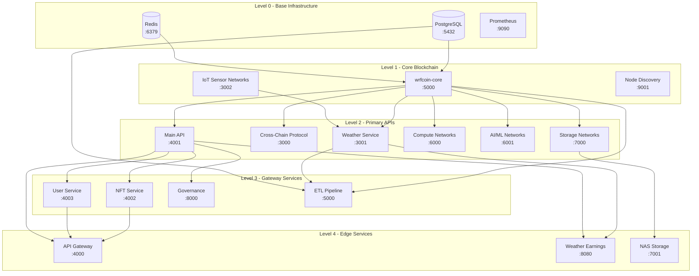

# WRFCoin Service Startup Sequence

This document describes the correct startup sequence for all WRFCoin platform services. Services must be started in the correct order to ensure proper initialization and dependency resolution.

## Service Dependency Diagram



## Startup Levels

### Level 0 - Base Infrastructure (Start First)

These services have no dependencies and must be started first:

| Service | Container | Port | Healthcheck Command |
|---------|-----------|------|---------------------|
| PostgreSQL | `wrfcoin-postgres` | 5432 | `pg_isready -U postgres` |
| Redis | `wrfcoin-redis` | 6379 | `redis-cli ping` |
| Prometheus | `wrfcoin-prometheus` | 9090 | `wget -q --spider http://localhost:9090/-/healthy` |

**Startup command:**
```bash
docker-compose up -d postgres redis prometheus
```

**Wait for readiness:**
```bash
# Wait for PostgreSQL
until docker exec wrfcoin-postgres pg_isready -U postgres; do sleep 2; done

# Wait for Redis
until docker exec wrfcoin-redis redis-cli ping | grep -q PONG; do sleep 2; done
```

### Level 1 - Core Blockchain

| Service | Container | Port | Dependencies | Healthcheck |
|---------|-----------|------|--------------|-------------|
| wrfcoin-core | `wrfcoin-core` | 5000 | PostgreSQL, Redis | `curl -f http://localhost:5000/health` |
| IoT Sensor Networks | `wrfcoin-iot` | 3002 | None | `curl -f http://localhost:3002/health` |
| Node Discovery | `wrfcoin-discovery` | 9001 | None | `curl -f http://localhost:9001/health` |

**Startup command:**
```bash
docker-compose up -d wrfcoin-core iot-sensor-networks node-discovery
```

### Level 2 - Primary APIs

| Service | Container | Port | Dependencies | Healthcheck |
|---------|-----------|------|--------------|-------------|
| Main API | `wrfcoin-api` | 4001 | wrfcoin-core, PostgreSQL, Redis | `curl -f http://localhost:4001/health` |
| Cross-Chain Protocol | `wrfcoin-crosschain` | 3000 | wrfcoin-core | `curl -f http://localhost:3000/health` |
| Weather Service | `wrfcoin-weather` | 3001 | wrfcoin-core, IoT | `curl -f http://localhost:3001/health` |
| Compute Networks | `wrfcoin-compute` | 6000 | wrfcoin-core | `curl -f http://localhost:6000/health` |
| AI/ML Networks | `wrfcoin-aiml` | 6001 | wrfcoin-core | `curl -f http://localhost:6001/health` |
| Storage Networks | `wrfcoin-storage` | 7000 | wrfcoin-core | `curl -f http://localhost:7000/health` |

**Startup command:**
```bash
docker-compose up -d main-api cross-chain-protocol weather-service compute-networks aiml-networks storage-networks
```

### Level 3 - Gateway Services

| Service | Container | Port | Dependencies | Healthcheck |
|---------|-----------|------|--------------|-------------|
| NFT Service | `wrfcoin-nft` | 4002 | Main API | `curl -f http://localhost:4002/health` |
| User Service | `wrfcoin-user` | 4003 | Main API | `curl -f http://localhost:4003/health` |
| Governance | `wrfcoin-governance` | 8000 | Main API | `curl -f http://localhost:8000/health` |
| ETL Pipeline | `wrfcoin-etl` | 5000 | wrfcoin-core, Weather, PostgreSQL | `curl -f http://localhost:5000/health` |

**Startup command:**
```bash
docker-compose up -d nft-service user-service governance etl-pipeline
```

### Level 4 - Edge Services

| Service | Container | Port | Dependencies | Healthcheck |
|---------|-----------|------|--------------|-------------|
| API Gateway | `wrfcoin-gateway` | 4000 | NFT, User, Main API | `curl -f http://localhost:4000/health` |
| Weather Earnings | `wrfcoin-earnings` | 8080 | Weather, Main API | `curl -f http://localhost:8080/health` |
| NAS Storage | `wrfcoin-nas` | 7001 | Storage Networks | `curl -f http://localhost:7001/health` |

**Startup command:**
```bash
docker-compose up -d api-gateway weather-earnings nas-storage
```

## Full Startup Script

```bash
#!/bin/bash
# WRFCoin Full Service Startup Script

set -e

echo "Starting WRFCoin Platform Services..."

# Level 0 - Base Infrastructure
echo "Starting Level 0 - Base Infrastructure..."
docker-compose up -d postgres redis prometheus
sleep 5

# Wait for Level 0 health
echo "Waiting for base infrastructure..."
timeout 60 bash -c 'until docker exec wrfcoin-postgres pg_isready -U postgres 2>/dev/null; do sleep 2; done'
timeout 30 bash -c 'until docker exec wrfcoin-redis redis-cli ping 2>/dev/null | grep -q PONG; do sleep 2; done'

# Level 1 - Core Blockchain
echo "Starting Level 1 - Core Blockchain..."
docker-compose up -d wrfcoin-core iot-sensor-networks node-discovery
sleep 5

# Wait for Level 1 health
echo "Waiting for blockchain core..."
timeout 60 bash -c 'until curl -sf http://localhost:5000/health >/dev/null 2>&1; do sleep 2; done'

# Level 2 - Primary APIs
echo "Starting Level 2 - Primary APIs..."
docker-compose up -d main-api cross-chain-protocol weather-service compute-networks aiml-networks storage-networks
sleep 5

# Wait for Level 2 health
echo "Waiting for primary APIs..."
timeout 60 bash -c 'until curl -sf http://localhost:4001/health >/dev/null 2>&1; do sleep 2; done'

# Level 3 - Gateway Services
echo "Starting Level 3 - Gateway Services..."
docker-compose up -d nft-service user-service governance etl-pipeline
sleep 3

# Level 4 - Edge Services
echo "Starting Level 4 - Edge Services..."
docker-compose up -d api-gateway weather-earnings nas-storage
sleep 3

# Final health check
echo "Running final health checks..."
SERVICES=(
  "http://localhost:5000/health:wrfcoin-core"
  "http://localhost:4001/health:main-api"
  "http://localhost:4000/health:api-gateway"
)

ALL_HEALTHY=true
for service in "${SERVICES[@]}"; do
  URL="${service%%:*}"
  NAME="${service##*:}"
  if curl -sf "$URL" >/dev/null 2>&1; then
    echo "  $NAME: healthy"
  else
    echo "  $NAME: UNHEALTHY"
    ALL_HEALTHY=false
  fi
done

if [ "$ALL_HEALTHY" = true ]; then
  echo "All services started successfully!"
else
  echo "WARNING: Some services may not be healthy"
  exit 1
fi
```

## Troubleshooting

### Common Startup Issues

#### PostgreSQL Connection Refused
```bash
# Check if PostgreSQL is running
docker logs wrfcoin-postgres

# Verify connection
docker exec wrfcoin-postgres pg_isready -U postgres
```

#### Redis Authentication Failed
```bash
# Check Redis logs
docker logs wrfcoin-redis

# Verify REDIS_PASSWORD is set
echo $REDIS_PASSWORD
```

#### wrfcoin-core Fails to Start
```bash
# Check logs
docker logs wrfcoin-core

# Common causes:
# - Database not migrated: run migrations first
# - Missing environment variables: check .env file
# - Port already in use: check for conflicting services
```

#### Service Dependency Not Ready
If a service fails because its dependency isn't ready:
```bash
# Restart the failed service after dependency is healthy
docker-compose restart <service-name>

# Or increase the start_period in docker-compose.yml healthcheck
```

### Health Check Endpoints

All services expose health endpoints at `/health`:
```bash
# Quick health check all services
for port in 5000 4001 4000 3000 3001 6000 6001 7000 8000 8080; do
  echo -n "Port $port: "
  curl -sf "http://localhost:$port/health" && echo "OK" || echo "FAILED"
done
```

### Graceful Shutdown

To properly shut down services, reverse the startup order:
```bash
# Stop services in reverse order
docker-compose down
```

For a graceful shutdown with service draining:
```bash
# Signal services to stop accepting new requests
# Wait for in-flight requests to complete
# Then stop containers
docker-compose stop --timeout 30
docker-compose down
```

## Environment Variables

Ensure these environment variables are set before starting:

| Variable | Description | Required |
|----------|-------------|----------|
| `DATABASE_URL` | PostgreSQL connection string | Yes |
| `REDIS_PASSWORD` | Redis authentication password | Yes |
| `JWT_SECRET` | JWT signing secret | Yes |
| `NODE_ENV` | Environment (production/development) | Yes |
| `BLOCKCHAIN_NODE_URL` | Blockchain RPC endpoint | Yes |

## Related Documentation

- [Deployment Runbooks](./runbooks/)
- [Docker Compose Configuration](../../infra/docker/)
- [CLAUDE.md](../../CLAUDE.md) - Full platform documentation
