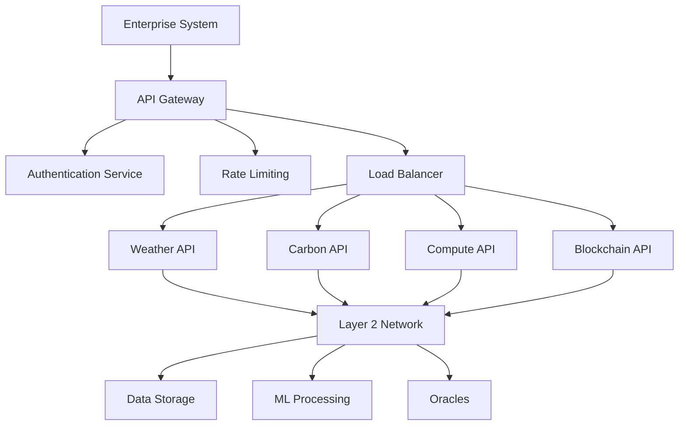

# Enterprise Integration Guide - Wrfcoin Climate Platform

**Date Created:** May 21, 2025  
**Last Edited:** May 26, 2025

## 🏢 Overview

This guide helps enterprise organizations integrate with Wrfcoin's climate blockchain platform. Our
enterprise-grade infrastructure supports mission-critical applications with 99.9% uptime, regulatory
compliance, and institutional security standards, featuring 13 cross-chain bridge protocols,
AI-enhanced validation systems, and comprehensive IoT sensor network integrations.

## 🎯 Enterprise Use Cases

### Insurance Industry

- **Parametric Weather Insurance**: Automated payouts based on weather triggers
- **Climate Risk Assessment**: Real-time risk scoring for underwriting
- **Catastrophe Modeling**: Enhanced models with blockchain-verified data
- **Crop Insurance**: Satellite and sensor data for agricultural coverage

### Financial Services

- **Carbon Credit Trading**: Verified environmental asset marketplace
- **Climate Derivatives**: Weather-based financial instruments
- **ESG Reporting**: Blockchain-verified sustainability metrics
- **Green Bonds**: Transparent impact tracking and reporting

### Government & Agencies

- **Environmental Monitoring**: Real-time pollution and climate tracking
- **Disaster Response**: Early warning systems with verified data
- **Carbon Accounting**: National and regional emissions tracking
- **Research Collaboration**: Secure data sharing between institutions

### Energy & Utilities

- **Renewable Forecasting**: AI-powered solar and wind predictions
- **Grid Optimization**: Weather-aware load balancing
- **Carbon Offset Programs**: Verified renewable energy certificates
- **Climate Adaptation**: Infrastructure planning with climate projections

## 🔧 Integration Architecture

### Enterprise API Gateway



### High-Availability Deployment

```yaml
# docker-compose-enterprise.yml
version: '3.8'
services:
  wrfcoin-enterprise:
    image: wrfcoin/enterprise:latest
    deploy:
      replicas: 3
      resources:
        limits:
          cpus: '4.0'
          memory: 8G
        reservations:
          cpus: '2.0'
          memory: 4G
      restart_policy:
        condition: on-failure
        max_attempts: 3
    environment:
      - NODE_ENV=production
      - ENTERPRISE_MODE=true
      - REDUNDANCY_LEVEL=high
      - SLA_TIER=enterprise
    volumes:
      - enterprise_data:/app/data
      - enterprise_logs:/app/logs
    networks:
      - enterprise_network

  load_balancer:
    image: nginx:alpine
    ports:
      - '443:443'
      - '80:80'
    volumes:
      - ./nginx-enterprise.conf:/etc/nginx/nginx.conf
      - ./ssl:/etc/nginx/ssl
    depends_on:
      - wrfcoin-enterprise

volumes:
  enterprise_data:
    driver: local
    driver_opts:
      type: nfs
      o: addr=nfs-server,rw
      device: ':/enterprise/data'
```

## 🔐 Security & Compliance

### Enterprise Security Framework

```typescript
interface EnterpriseSecurityConfig {
  authentication: {
    sso: boolean;
    mfa: boolean;
    certificateAuth: boolean;
    apiKeyRotation: number; // days
  };
  networking: {
    vpnRequired: boolean;
    allowedIPs: string[];
    tlsVersion: string;
    certificatePinning: boolean;
  };
  audit: {
    enableLogging: boolean;
    retentionPeriod: number; // days
    complianceStandards: string[];
    realTimeAlerts: boolean;
  };
  dataProtection: {
    encryptionAtRest: boolean;
    encryptionInTransit: boolean;
    keyManagement: 'hsm' | 'vault' | 'managed';
    dataResidency: string[];
  };
}

const enterpriseConfig: EnterpriseSecurityConfig = {
  authentication: {
    sso: true,
    mfa: true,
    certificateAuth: true,
    apiKeyRotation: 90,
  },
  networking: {
    vpnRequired: true,
    allowedIPs: ['10.0.0.0/8', '172.16.0.0/12'],
    tlsVersion: '1.3',
    certificatePinning: true,
  },
  audit: {
    enableLogging: true,
    retentionPeriod: 2557, // 7 years
    complianceStandards: ['SOX', 'GDPR', 'ISO27001'],
    realTimeAlerts: true,
  },
  dataProtection: {
    encryptionAtRest: true,
    encryptionInTransit: true,
    keyManagement: 'hsm',
    dataResidency: ['US', 'EU'],
  },
};
```

### GDPR Compliance Implementation

```typescript
class GDPRComplianceManager {
  async handleDataRequest(userId: string, requestType: 'access' | 'portability' | 'deletion') {
    switch (requestType) {
      case 'access':
        return await this.generateDataReport(userId);
      case 'portability':
        return await this.exportUserData(userId);
      case 'deletion':
        return await this.anonymizeUserData(userId);
    }
  }

  async generateDataReport(userId: string) {
    const userData = await this.blockchain.getUserData(userId);
    const processedData = await this.analytics.getUserProcessingLog(userId);

    return {
      personalData: this.sanitizeForExport(userData),
      processingHistory: processedData,
      retentionPeriods: this.getRetentionSchedule(userId),
      thirdPartySharing: this.getDataSharingLog(userId),
    };
  }

  async anonymizeUserData(userId: string) {
    // Blockchain data cannot be deleted, so we anonymize
    const anonymizationHash = this.generateAnonymizationHash();

    await this.blockchain.replaceUserIdentifiers(userId, anonymizationHash);
    await this.database.anonymizeUserRecords(userId);
    await this.analytics.purgeUserData(userId);

    return { success: true, anonymizationId: anonymizationHash };
  }
}
```

## 💼 Industry-Specific Integrations

### Insurance Company Integration

```java
// Java SDK example for insurance integration
public class ClimateInsuranceService {
    private WrfcoinClient wrfcoinClient;
    private RiskCalculationEngine riskEngine;

    public PolicyQuote calculatePremium(PolicyRequest request) {
        // Get historical climate data
        List<WeatherData> historicalData = wrfcoinClient
            .getHistoricalWeather(request.getLocation(), "5 years");

        // Get climate projections
        ClimateProjection projection = wrfcoinClient
            .getClimateProjection(request.getLocation(), request.getDuration());

        // Calculate risk using proprietary models
        RiskAssessment risk = riskEngine.assessRisk(
            historicalData,
            projection,
            request.getCoverageType()
        );

        // Generate premium quote
        return PolicyQuote.builder()
            .baseRate(risk.getBaseRate())
            .riskMultiplier(risk.getRiskMultiplier())
            .premium(calculatePremium(risk))
            .confidence(risk.getConfidence())
            .dataQuality(getDataQualityScore(historicalData))
            .build();
    }

    public void processParametricClaim(String policyId) {
        Policy policy = policyRepository.findById(policyId);

        // Get real-time weather data
        WeatherData currentWeather = wrfcoinClient
            .getCurrentWeather(policy.getLocation());

        // Check trigger conditions
        if (policy.getTriggerCondition().isMet(currentWeather)) {
            // Automatic payout via smart contract
            SmartContract contract = wrfcoinClient
                .getContract(policy.getContractAddress());

            contract.triggerPayout(policyId, currentWeather);
        }
    }
}
```

### Financial Institution Integration

```csharp
// C# SDK example for financial services
public class CarbonTradingService
{
    private readonly IWrfcoinClient _wrfcoinClient;
    private readonly IComplianceService _compliance;

    public async Task<CarbonCreditPortfolio> GetPortfolioAsync(string institutionId)
    {
        var holdings = await _wrfcoinClient.GetCarbonHoldingsAsync(institutionId);
        var marketData = await _wrfcoinClient.GetCarbonMarketDataAsync();

        return new CarbonCreditPortfolio
        {
            TotalCredits = holdings.Sum(h => h.Quantity),
            MarketValue = CalculateMarketValue(holdings, marketData),
            VintageDistribution = GetVintageDistribution(holdings),
            GeographicDistribution = GetGeographicDistribution(holdings),
            VerificationStatus = await ValidateHoldings(holdings),
            ESGImpact = await CalculateESGImpact(holdings)
        };
    }

    public async Task<TradeResult> ExecuteTradeAsync(CarbonTradeOrder order)
    {
        // Pre-trade compliance checks
        var complianceResult = await _compliance.ValidateTradeAsync(order);
        if (!complianceResult.IsValid)
        {
            return TradeResult.Failed(complianceResult.Errors);
        }

        // Execute trade on blockchain
        var transaction = await _wrfcoinClient.ExecuteCarbonTradeAsync(order);

        // Post-trade reporting
        await _compliance.ReportTradeAsync(transaction);

        return TradeResult.Success(transaction.Hash);
    }
}
```

### Government Agency Integration

```python
# Python SDK example for government integration
class EnvironmentalMonitoringService:
    def __init__(self, wrfcoin_client, agency_config):
        self.client = wrfcoin_client
        self.config = agency_config

    async def setup_monitoring_network(self, region_config):
        """Set up comprehensive environmental monitoring"""
        monitoring_stations = []

        for station_config in region_config['stations']:
            # Register monitoring station
            station = await self.client.register_monitoring_station(
                location=station_config['location'],
                station_type=station_config['type'],
                parameters=station_config['parameters'],
                agency_id=self.config['agency_id']
            )

            # Set up real-time data streaming
            await station.setup_data_stream(
                frequency=station_config['frequency'],
                quality_threshold=station_config['quality_threshold']
            )

            monitoring_stations.append(station)

        return monitoring_stations

    async def generate_environmental_report(self, region, period):
        """Generate comprehensive environmental report"""

        # Collect data from all sources
        air_quality_data = await self.client.get_air_quality_data(region, period)
        water_quality_data = await self.client.get_water_quality_data(region, period)
        biodiversity_data = await self.client.get_biodiversity_data(region, period)

        # Analyze trends and patterns
        trends = await self.analyze_environmental_trends(
            air_quality_data, water_quality_data, biodiversity_data
        )

        # Generate policy recommendations
        recommendations = await self.generate_policy_recommendations(trends)

        # Create compliance report
        compliance_status = await self.assess_regulatory_compliance(
            air_quality_data, water_quality_data
        )

        return {
            'summary': trends,
            'detailed_data': {
                'air_quality': air_quality_data,
                'water_quality': water_quality_data,
                'biodiversity': biodiversity_data
            },
            'compliance_status': compliance_status,
            'recommendations': recommendations,
            'data_quality_score': self.calculate_data_quality_score(
                air_quality_data, water_quality_data, biodiversity_data
            )
        }
```

## 📊 Performance & SLA

### Enterprise Performance Guarantees

| Metric                   | Standard    | Premium     | Enterprise   |
| ------------------------ | ----------- | ----------- | ------------ |
| API Uptime               | 99.5%       | 99.9%       | 99.95%       |
| Response Time            | <500ms      | <200ms      | <100ms       |
| Throughput               | 10K req/min | 50K req/min | 500K req/min |
| Data Freshness           | <5 minutes  | <2 minutes  | <30 seconds  |
| Support Response         | 4 hours     | 1 hour      | 15 minutes   |
| Dedicated Infrastructure | No          | Yes         | Yes          |
| Custom SLA               | No          | Limited     | Full         |

### Monitoring and Alerting

```typescript
interface EnterpriseMonitoring {
  metrics: {
    api_response_time: number;
    error_rate: number;
    throughput: number;
    data_quality_score: number;
    blockchain_sync_status: boolean;
  };
  alerts: {
    sla_violation: boolean;
    data_quality_degradation: boolean;
    security_incident: boolean;
    service_disruption: boolean;
  };
  dashboards: {
    executive_summary: string;
    technical_overview: string;
    compliance_status: string;
    cost_analysis: string;
  };
}

class EnterpriseMonitoringService {
  private metrics: EnterpriseMetrics;
  private alertManager: AlertManager;

  async monitorSLA(): Promise<SLAStatus> {
    const currentMetrics = await this.collectMetrics();
    const slaStatus = this.evaluateSLA(currentMetrics);

    if (!slaStatus.inCompliance) {
      await this.alertManager.triggerSLAAlert(slaStatus);
      await this.initiateRecoveryProcedures(slaStatus);
    }

    return slaStatus;
  }

  async generateExecutiveDashboard(): Promise<ExecutiveDashboard> {
    const metrics = await this.getAggregatedMetrics('24h');
    const costs = await this.getCostAnalysis('30d');
    const compliance = await this.getComplianceStatus();

    return {
      systemHealth: this.calculateHealthScore(metrics),
      businessImpact: this.calculateBusinessImpact(metrics, costs),
      riskAssessment: this.assessRisks(metrics, compliance),
      recommendations: await this.generateRecommendations(metrics),
    };
  }
}
```

## 💰 Pricing & Licensing

### Enterprise Pricing Tiers

**Starter Enterprise** - $5,000/month

- 100K API calls/month
- Basic SLA (99.5% uptime)
- Email support
- Standard security features

**Professional Enterprise** - $15,000/month

- 1M API calls/month
- Enhanced SLA (99.9% uptime)
- Priority support + dedicated success manager
- Advanced security & compliance features
- Custom integrations

**Enterprise Plus** - Custom pricing

- Unlimited API calls
- Premium SLA (99.95% uptime)
- 24/7 dedicated support
- Full compliance suite
- Custom development
- On-premises deployment options

### Volume Discounts

```javascript
const calculateEnterpriseDiscount = (monthlyAPIcalls, contractLength) => {
  let basePrice = calculateBasePrice(monthlyAPIcalls);
  let discount = 0;

  // Volume discounts
  if (monthlyAPIcalls > 10_000_000) discount += 0.2;
  else if (monthlyAPIcalls > 5_000_000) discount += 0.15;
  else if (monthlyAPIcalls > 1_000_000) discount += 0.1;

  // Contract length discounts
  if (contractLength >= 36) discount += 0.15;
  else if (contractLength >= 24) discount += 0.1;
  else if (contractLength >= 12) discount += 0.05;

  return basePrice * (1 - Math.min(discount, 0.35)); // Max 35% discount
};
```

## 🚀 Deployment Options

### Cloud Deployment (Recommended)

```bash
# Terraform configuration for enterprise deployment
resource "aws_ecs_cluster" "wrfcoin_enterprise" {
  name = "wrfcoin-enterprise"

  setting {
    name  = "containerInsights"
    value = "enabled"
  }
}

resource "aws_ecs_service" "wrfcoin_api" {
  name            = "wrfcoin-api"
  cluster         = aws_ecs_cluster.wrfcoin_enterprise.id
  task_definition = aws_ecs_task_definition.wrfcoin_api.arn
  desired_count   = 3

  deployment_configuration {
    maximum_percent         = 200
    minimum_healthy_percent = 100
  }

  load_balancer {
    target_group_arn = aws_lb_target_group.wrfcoin_api.arn
    container_name   = "wrfcoin-api"
    container_port   = 80
  }
}
```

### On-Premises Deployment

```yaml
# Kubernetes deployment for on-premises
apiVersion: apps/v1
kind: Deployment
metadata:
  name: wrfcoin-enterprise
  namespace: wrfcoin
spec:
  replicas: 3
  strategy:
    type: RollingUpdate
    rollingUpdate:
      maxSurge: 1
      maxUnavailable: 0
  selector:
    matchLabels:
      app: wrfcoin-enterprise
  template:
    metadata:
      labels:
        app: wrfcoin-enterprise
    spec:
      containers:
        - name: wrfcoin-api
          image: wrfcoin/enterprise:latest
          ports:
            - containerPort: 8080
          env:
            - name: NODE_ENV
              value: 'production'
            - name: ENTERPRISE_MODE
              value: 'true'
          resources:
            requests:
              memory: '2Gi'
              cpu: '1000m'
            limits:
              memory: '4Gi'
              cpu: '2000m'
          livenessProbe:
            httpGet:
              path: /health
              port: 8080
            initialDelaySeconds: 30
            periodSeconds: 10
          readinessProbe:
            httpGet:
              path: /ready
              port: 8080
            initialDelaySeconds: 5
            periodSeconds: 5
```

## 📞 Enterprise Support

### Support Channels

- **Dedicated Success Manager**: Assigned to Enterprise Plus customers
- **24/7 Technical Support**: Phone, email, and chat support
- **Developer Portal**: Self-service documentation and tools
- **Professional Services**: Custom development and integration
- **Training Programs**: Technical training for development teams

### Support SLAs

| Severity | Response Time | Resolution Time |
| -------- | ------------- | --------------- |
| Critical | 15 minutes    | 2 hours         |
| High     | 1 hour        | 8 hours         |
| Medium   | 4 hours       | 24 hours        |
| Low      | 8 hours       | 72 hours        |

### Getting Started

1. **Contact Enterprise Sales**: [enterprise@wrfcoin.org](mailto:enterprise@wrfcoin.org)
2. **Technical Assessment**: Architecture review with our solutions team
3. **Proof of Concept**: 30-day pilot program with your data
4. **Custom Deployment**: Tailored implementation for your infrastructure
5. **Go-Live Support**: Dedicated support during production launch

Transform your organization's climate capabilities with Wrfcoin's enterprise-grade blockchain
platform. Contact us today to begin your journey toward climate-intelligent business operations.
