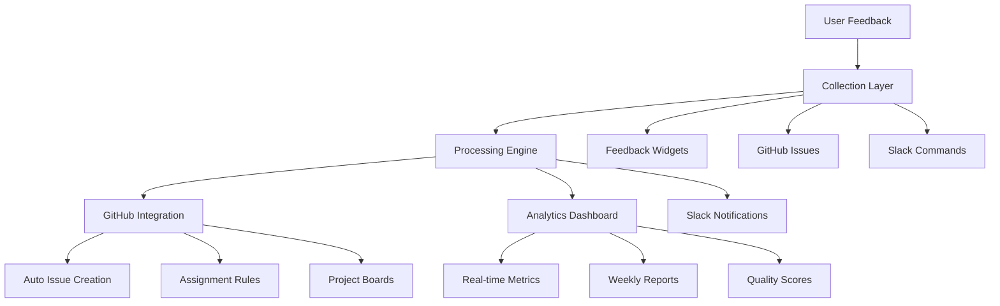
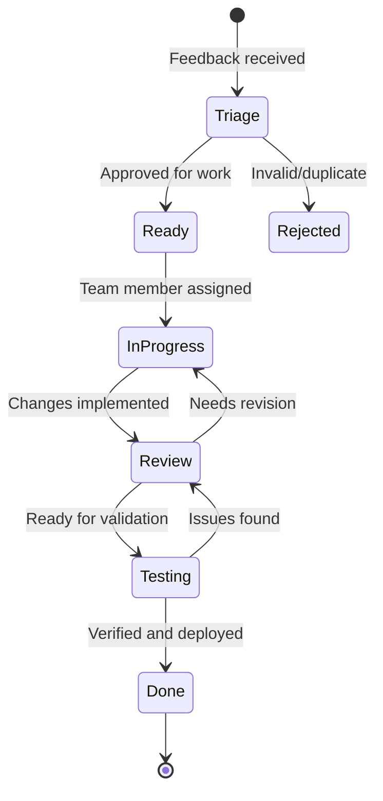

# Team Training for Documentation Feedback System

This guide provides comprehensive training materials for the documentation team to effectively use
and maintain the feedback collection and processing system.

## Overview

The documentation feedback system is designed to help the team:

- **Collect Structured Feedback** from users across multiple channels
- **Process Feedback Efficiently** using automated workflows
- **Track Quality Metrics** to measure documentation effectiveness
- **Improve Continuously** based on data-driven insights

## 1. System Architecture Overview

### Core Components



### Data Flow

1. **Collection**: Users submit feedback via multiple channels
2. **Triage**: System automatically categorizes and prioritizes
3. **Assignment**: Issues assigned based on category and priority
4. **Processing**: Team members work on improvements
5. **Resolution**: Changes implemented and verified
6. **Analytics**: Metrics tracked and reported

## 2. Daily Operations

### Morning Routine

**Documentation Team Lead (15 minutes daily)**

```bash
# Check overnight feedback and urgent issues
curl -s "http://localhost:3001/api/feedback/urgent" | jq '.'

# Review GitHub issues dashboard
open "https://github.com/wrfcoin/wrfcoin/projects/5"

# Check Slack notifications
# Review #docs-urgent and #docs-feedback channels
```

**Team Members (10 minutes daily)**

1. **Check Assigned Issues**

   - Review GitHub notifications
   - Check assigned documentation issues
   - Prioritize work based on urgency and impact

2. **Review Feedback Dashboard**
   - Access analytics dashboard: `http://localhost:3000/admin/docs`
   - Check satisfaction scores for your areas
   - Note trending issues or topics

### Weekly Routine

**Team Lead (30 minutes weekly)**

```javascript
// Generate weekly report
const reportGenerator = new WeeklyReportGenerator();
const report = await reportGenerator.generateAndSendReport();

// Review team performance metrics
const teamMetrics = await getTeamProductivityMetrics();

// Plan sprint priorities based on feedback trends
const priorities = await generateSprintPriorities();
```

**Team Members (20 minutes weekly)**

1. **Sprint Planning Participation**

   - Review feedback-driven priorities
   - Estimate effort for documentation improvements
   - Commit to sprint goals

2. **Retrospective Contribution**
   - Share insights from user feedback
   - Suggest process improvements
   - Identify documentation gaps

## 3. Feedback Processing Workflows

### High-Priority Feedback (Within 4 hours)

```yaml
Priority: Urgent/High
Response Time: 4 hours
Process:
  1. Immediate notification via Slack 2. Auto-assignment to team lead 3. Quick assessment and triage
  4. Assignment to appropriate specialist 5. Fast-track through approval process
```

**Example Workflow:**

```javascript
// Automated urgent feedback workflow
async function processUrgentFeedback(feedback) {
  // 1. Immediate notification
  await slackService.notifyUrgentFeedback(feedback);

  // 2. Create GitHub issue
  const issue = await githubService.createIssueFromFeedback(feedback);

  // 3. Auto-assign to team lead
  await githubService.assignToTeamLead(issue.number);

  // 4. Set high priority labels
  await githubService.addLabels(issue.number, ['priority:urgent', 'needs-immediate-attention']);

  // 5. Add to sprint board
  await projectBoard.moveToInProgress(issue.number);
}
```

### Standard Feedback (Within 2 business days)

```yaml
Priority: Medium/Low
Response Time: 2 business days
Process:
  1. Automatic categorization and labeling 2. Assignment based on expertise areas 3. Standard review
  and approval process 4. Implementation in next sprint cycle
```

### Community Feedback (Within 1 week)

```yaml
Source: Community contributions
Response Time: 1 week
Process:
  1. Community recognition and thanks 2. Evaluation for integration 3. Collaboration with
  contributor 4. Implementation with attribution
```

## 4. Issue Management

### GitHub Issue Lifecycle



### Issue Labels and Organization

**Priority Labels:**

- `priority:urgent` - Critical issues blocking users
- `priority:high` - Important improvements needed soon
- `priority:medium` - Standard improvements
- `priority:low` - Nice-to-have enhancements

**Category Labels:**

- `category:troubleshooting` - Troubleshooting guides
- `category:onboarding` - Getting started documentation
- `category:api-docs` - API documentation
- `category:code-standards` - Code standards and style guides
- `category:search` - Search functionality issues
- `category:navigation` - Site navigation problems

**Type Labels:**

- `type:bug` - Errors or incorrect information
- `type:enhancement` - New content or improvements
- `type:positive-feedback` - Positive user feedback
- `type:suggestion` - User suggestions

**Status Labels:**

- `status:triage` - Awaiting initial review
- `status:ready` - Approved and ready for work
- `status:in-progress` - Currently being worked on
- `status:review` - Awaiting review
- `status:blocked` - Blocked by external dependencies

### Assignment Guidelines

**By Category:**

```javascript
const assignmentRules = {
  'category:troubleshooting': ['@troubleshooting-specialist', '@senior-dev'],
  'category:onboarding': ['@onboarding-lead', '@technical-writer'],
  'category:api-docs': ['@api-team-lead', '@backend-dev'],
  'category:code-standards': ['@code-standards-maintainer'],
  'category:search': ['@ux-lead', '@frontend-dev'],
  'category:navigation': ['@ux-lead', '@product-manager'],
};
```

**By Priority:**

- **Urgent**: Team lead + category specialist
- **High**: Category specialist + reviewer
- **Medium**: Category specialist
- **Low**: Junior team member or community contributor

## 5. Analytics and Reporting

### Daily Metrics Dashboard

**Key Performance Indicators:**

```typescript
interface DailyMetrics {
  // Feedback Volume
  newFeedback: number;
  totalPendingFeedback: number;

  // Response Times
  averageResponseTime: number; // hours
  slaBreaches: number;

  // Quality Scores
  satisfactionScore: number; // 1-5 scale
  documentationHealthScore: number; // 1-100

  // Team Performance
  issuesProcessed: number;
  issuesResolved: number;
  teamVelocity: number;
}
```

**Dashboard Access:**

- **Team Lead**: Full analytics dashboard with all metrics
- **Team Members**: Personal metrics and assigned area performance
- **Management**: Executive summary and trend reports

### Weekly Reporting

**Automated Weekly Report Contents:**

```markdown
# Weekly Documentation Feedback Report

## Executive Summary

- Total feedback received: {totalFeedback}
- User satisfaction score: {satisfactionScore}/5.0
- Documentation health score: {healthScore}/100
- Issues resolved: {resolvedIssues}

## Top Issues This Week

1. {topIssue1} - {impact}
2. {topIssue2} - {impact}
3. {topIssue3} - {impact}

## Team Performance

- Average response time: {avgResponseTime}
- SLA compliance: {slaCompliance}%
- Community contributions: {communityContributions}

## Recommendations

- {recommendation1}
- {recommendation2}
- {recommendation3}

## Next Week Priorities

- {priority1}
- {priority2}
- {priority3}
```

### Monthly Review Process

**Monthly Team Meeting Agenda:**

1. **Metrics Review** (15 minutes)

   - Dashboard walkthrough
   - Trend analysis
   - Goal progress assessment

2. **Process Improvement** (20 minutes)

   - Workflow efficiency review
   - Tool effectiveness assessment
   - Pain point identification

3. **Content Strategy** (15 minutes)

   - High-impact improvement opportunities
   - Content gap analysis
   - Community feedback themes

4. **Planning** (10 minutes)
   - Next month's priorities
   - Resource allocation
   - Training needs

## 6. Quality Assurance

### Documentation Quality Checklist

**Before Publishing Changes:**

```markdown
- [ ] Content is accurate and up-to-date
- [ ] Links are functional and relevant
- [ ] Code examples are tested and working
- [ ] Screenshots are current (if applicable)
- [ ] Cross-references are updated
- [ ] SEO metadata is optimized
- [ ] Accessibility standards are met
- [ ] Mobile responsiveness verified
```

### Review Process

**Peer Review Checklist:**

```markdown
## Content Review

- [ ] Information is accurate and complete
- [ ] Tone and style match documentation standards
- [ ] Technical accuracy verified
- [ ] User perspective considered

## Technical Review

- [ ] Links tested and functional
- [ ] Code examples validated
- [ ] Cross-platform compatibility checked
- [ ] Performance impact assessed

## User Experience Review

- [ ] Clear and understandable language
- [ ] Logical information flow
- [ ] Appropriate depth and detail
- [ ] Actionable instructions provided
```

### Testing Changes

**User Acceptance Testing:**

```bash
# Test documentation changes
npm run docs:test

# Validate links
npm run docs:validate-links

# Check accessibility
npm run docs:a11y-test

# Performance audit
npm run docs:lighthouse

# User feedback simulation
npm run docs:user-test
```

## 7. Tools and Technology Training

### Feedback Dashboard

**Accessing the Dashboard:**

```bash
# Development environment
http://localhost:3000/admin/docs

# Production environment
https://analytics.docs.wrfcoin.org
```

**Key Features:**

- Real-time feedback monitoring
- Satisfaction score tracking
- Page performance analytics
- Team productivity metrics
- Trend analysis and reporting

### GitHub Integration

**Essential Commands:**

```bash
# Check assigned issues
gh issue list --assignee @me --label "documentation"

# Create new documentation issue
gh issue create --title "Update API docs" --label "documentation,type:enhancement"

# Update issue status
gh issue edit 123 --add-label "status:in-progress"

# Close resolved issue
gh issue close 123 --comment "Documentation updated and deployed"
```

**Project Board Navigation:**

- **Triage**: New feedback awaiting review
- **Ready**: Approved work ready to start
- **In Progress**: Currently being worked on
- **Review**: Awaiting review and approval
- **Done**: Completed and verified

### Slack Integration

**Key Channels:**

- `#docs-urgent` - Urgent feedback requiring immediate attention
- `#docs-feedback` - General feedback and discussions
- `#documentation-team` - Team coordination and updates

**Useful Slash Commands:**

```bash
# Quick feedback submission
/docs-feedback [page-url] [feedback-text]

# Check team status
/docs-status

# Generate report
/docs-report weekly

# Get help
/docs-help
```

### Analytics Tools

**Prometheus Queries:**

```promql
# Documentation satisfaction score
documentation_satisfaction_score

# Feedback response time
histogram_quantile(0.95, rate(feedback_response_time_seconds_bucket[5m]))

# Page view trends
rate(documentation_page_views_total[1h])

# Issue resolution rate
rate(documentation_issues_resolved_total[1d])
```

**Grafana Dashboards:**

- Documentation Health Overview
- Team Performance Metrics
- User Satisfaction Trends
- Content Performance Analysis

## 8. Troubleshooting Common Issues

### Feedback System Issues

**Problem**: Feedback widget not appearing on pages

```bash
# Check widget deployment
curl -s "https://docs.wrfcoin.org/assets/feedback-widget.js" | head -n 5

# Verify configuration
grep -r "feedback-widget" /path/to/docs/

# Test widget functionality
npm run test:feedback-widget
```

**Problem**: GitHub issues not being created automatically

```bash
# Check GitHub App permissions
curl -H "Authorization: token $GITHUB_TOKEN" \
     "https://api.github.com/app/installations"

# Verify webhook configuration
curl -H "Authorization: token $GITHUB_TOKEN" \
     "https://api.github.com/repos/wrfcoin/wrfcoin/hooks"

# Test feedback processing
node scripts/test-feedback-processing.js
```

**Problem**: Slack notifications not working

```bash
# Test Slack webhook
curl -X POST -H 'Content-type: application/json' \
     --data '{"text":"Test notification"}' \
     $SLACK_WEBHOOK_URL

# Check bot permissions
curl -H "Authorization: Bearer $SLACK_BOT_TOKEN" \
     "https://slack.com/api/auth.test"

# Verify channel configuration
node scripts/verify-slack-config.js
```

### Analytics Issues

**Problem**: Dashboard showing no data

```bash
# Check database connection
psql $DATABASE_URL -c "SELECT COUNT(*) FROM feedback_entries;"

# Verify analytics service
curl -s "http://localhost:3001/api/analytics/health"

# Check Redis cache
redis-cli ping
```

**Problem**: Metrics not updating

```bash
# Restart analytics processor
pm2 restart analytics-processor

# Check log files
tail -f logs/analytics-processor.log

# Verify cron jobs
crontab -l | grep analytics
```

### Performance Issues

**Problem**: Slow dashboard loading

```bash
# Check database performance
EXPLAIN ANALYZE SELECT * FROM feedback_entries WHERE created_at > NOW() - INTERVAL '1 week';

# Monitor system resources
htop

# Analyze database queries
pg_stat_statements
```

**Problem**: High memory usage

```bash
# Check Node.js memory usage
node --inspect scripts/memory-profiler.js

# Monitor Redis memory
redis-cli info memory

# Analyze heap dumps
npm run analyze:memory
```

## 9. Advanced Features

### Custom Analytics Queries

**User Behavior Analysis:**

```sql
-- Most visited pages with low satisfaction
SELECT
    page_id,
    COUNT(*) as visits,
    AVG(CASE WHEN feedback_type = 'positive' THEN 5
             WHEN feedback_type = 'negative' THEN 1
             ELSE 3 END) as avg_satisfaction
FROM feedback_entries
WHERE created_at > NOW() - INTERVAL '30 days'
GROUP BY page_id
HAVING COUNT(*) > 10 AND avg_satisfaction < 3.5
ORDER BY visits DESC;
```

**Trending Issues:**

```sql
-- Issues gaining momentum
SELECT
    category,
    feedback_type,
    COUNT(*) as count,
    COUNT(*) - LAG(COUNT(*)) OVER (
        PARTITION BY category, feedback_type
        ORDER BY DATE_TRUNC('week', created_at)
    ) as growth
FROM feedback_entries
WHERE created_at > NOW() - INTERVAL '8 weeks'
GROUP BY category, feedback_type, DATE_TRUNC('week', created_at)
ORDER BY growth DESC NULLS LAST;
```

### Automated Reporting

**Custom Report Generation:**

```javascript
// Generate custom reports for stakeholders
class CustomReportGenerator {
  async generateExecutiveReport() {
    const report = {
      overview: await this.getOverviewMetrics(),
      trends: await this.getTrendAnalysis(),
      recommendations: await this.getRecommendations(),
      roi: await this.calculateROI(),
    };

    return this.formatExecutiveReport(report);
  }

  async generateTeamReport() {
    const report = {
      productivity: await this.getTeamProductivity(),
      workload: await this.getWorkloadAnalysis(),
      quality: await this.getQualityMetrics(),
      training: await this.getTrainingNeeds(),
    };

    return this.formatTeamReport(report);
  }
}
```

### Integration Extensions

**API for Custom Integrations:**

```javascript
// Extend system with custom integrations
const FeedbackAPI = {
  // Subscribe to feedback events
  subscribe: (eventType, callback) => {
    eventEmitter.on(eventType, callback);
  },

  // Custom feedback processing
  addProcessor: (processorName, processorFunction) => {
    feedbackProcessors.set(processorName, processorFunction);
  },

  // Custom analytics
  addMetric: (metricName, calculationFunction) => {
    customMetrics.set(metricName, calculationFunction);
  },
};
```

## 10. Training Resources

### Video Tutorials

1. **System Overview** (10 minutes)

   - Architecture walkthrough
   - Key components explanation
   - User journey demonstration

2. **Daily Operations** (15 minutes)

   - Morning routine demonstration
   - Issue processing workflow
   - Dashboard navigation

3. **Advanced Features** (20 minutes)
   - Custom queries and reports
   - Integration setup
   - Troubleshooting techniques

### Interactive Training

**Hands-on Exercises:**

1. **Feedback Processing**

   - Process 5 sample feedback entries
   - Create GitHub issues
   - Update project board status

2. **Analytics Review**

   - Generate weekly report
   - Identify trends and patterns
   - Create improvement recommendations

3. **Quality Assurance**
   - Review and test documentation changes
   - Validate feedback resolution
   - Update satisfaction metrics

### Certification Program

**Documentation Team Certification Levels:**

**Level 1: Feedback Processor**

- Can process standard feedback
- Understands triage workflow
- Can use basic analytics

**Level 2: Feedback Specialist**

- Can handle complex feedback
- Can customize reports
- Can train other team members

**Level 3: Feedback Administrator**

- Can configure system settings
- Can integrate new tools
- Can troubleshoot issues

---

**Next Steps:**

1. [Launch community contribution program](./community-program.md)
2. [Set up monitoring and alerting](./monitoring-setup.md)
3. [Create advanced automation workflows](./advanced-automation.md)

**Training Resources:**

- [Video Tutorial Library](./training-videos.md)
- [Interactive Exercises](./hands-on-training.md)
- [Certification Program](./certification.md)

**Last Updated**: January 2025  
**Version**: 1.0.0
