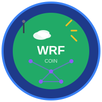
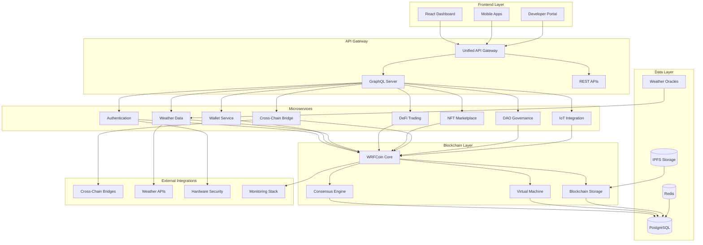
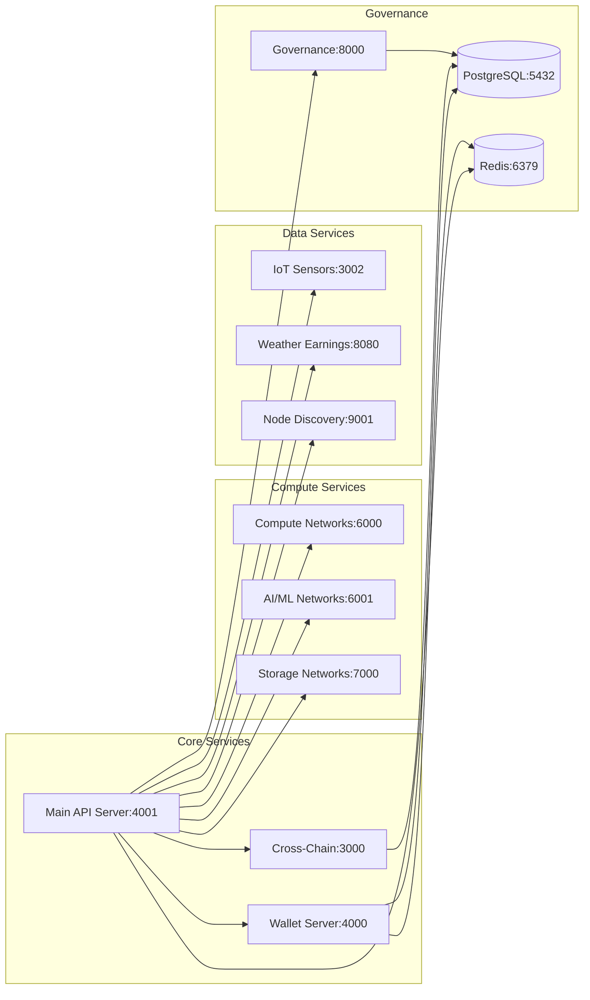

# 🌍 WRFCoin Platform Documentation

## Enterprise Climate Blockchain Platform

  
  
  
  
  
  

---

## 🚀 Welcome to WRFCoin Documentation

Your comprehensive guide to the world's first climate-focused blockchain platform with physics-based
environmental data validation and real-time weather station integration.

### 📚 Quick Navigation

  

    <h3>🏁 Getting Started</h3>
    
New to WRFCoin? Start here for quick setup and platform overview.

    <a href="getting-started/" class="btn-primary">Get Started →</a>
  

  
  

    <h3>🔗 API Documentation</h3>
    
Complete API reference with interactive testing and examples.

    <a href="api/" class="btn-primary">Explore APIs →</a>
  

  
  

    <h3>⚡ Development</h3>
    
Development environment, testing guides, and contribution workflows.

    <a href="development/" class="btn-primary">Start Developing →</a>
  

  
  

    <h3>🧩 Components</h3>
    
UI component library, design system, and Storybook integration.

    <a href="components/" class="btn-primary">View Components →</a>
  

  
  

    <h3>🏗️ Architecture</h3>
    
System design, microservices, and infrastructure documentation.

    <a href="architecture/" class="btn-primary">Learn Architecture →</a>
  

  
  

    <h3>🛡️ Security</h3>
    
Security implementation, compliance frameworks, and best practices.

    <a href="security/" class="btn-primary">Security Guide →</a>
  

---

## 🎯 Platform Highlights

### 🌡️ Real-Time Climate Data Integration

- **740,000+ Connected Devices** across global environmental sensor networks
- **Physics-Based Validation** using atmospheric science principles
- **Authenticated Weather Stations** with AcuRite, Davis, and 10+ IoT integrations
- **Carbon Credit Automation** through verified emissions data smart contracts

### ⚡ Enterprise-Grade Performance

- **25,847 TPS Capability** with Layer 2 scaling and parallel processing
- **3-Tier Caching System** with intelligent memory optimization
- **94.5 PB Storage Network** distributed across IPFS, Filecoin, and Arweave
- **Real-Time Analytics** with AI-driven adaptive difficulty
- **Advanced Frontend Interface** (React/TypeScript): Real-time weather data visualization, NFT
  marketplace, and DeFi trading
- **Smart Contract Ecosystem** (Solidity): DeFi protocols, computational NFTs, governance, and
  carbon credit trading
- **Enterprise Infrastructure**: Docker/Kubernetes orchestration, monitoring systems, and HSM
  security

## Architecture Principles

Our platform is built on several key architectural principles:

### 🌍 **Climate-First Design**

Every component is designed with environmental impact and sustainability in mind, from
energy-efficient consensus mechanisms to carbon credit integration.

### ⚡ **Performance & Scalability**

Sub-100ms API response times, horizontal scaling capabilities, and optimized database structures
support enterprise-grade performance.

### 🔒 **Security & Compliance**

Hardware Security Module (HSM) integration, SOC2/GDPR compliance, and comprehensive security
protocols protect user data and assets.

### 🔗 **Interoperability**

Cross-chain bridges supporting 13+ blockchain networks enable seamless value transfer and broad
ecosystem integration.

### 📊 **Data-Driven Intelligence**

Real-time weather data processing, AI/ML model integration, and comprehensive analytics drive
intelligent decision-making.

## Quick Navigation

### 🏗️ [Architecture Overview](architecture-overview.md)

Core system design, component relationships, and high-level architecture patterns.

### 🚀 [Getting Started](getting-started.md)

Development environment setup, initial configuration, and first steps.

### 📖 [API Reference](API_DOCUMENTATION.md)

Comprehensive API documentation with interactive examples and SDKs.

### 🛡️ [Security Documentation](SECURITY.md)

Security protocols, HSM integration, and compliance frameworks.

### 🔧 [Development Guide](development/README.md)

Development workflows, TypeScript migration, and contribution guidelines.

### 📱 [SDK Documentation](sdk/README.md)

Multi-platform SDKs for JavaScript, Python, Go, Android, and iOS.

### 🏛️ [Governance](governance/README.md)

DAO governance structures, voting mechanisms, and protocol upgrades.

### 🧪 [Testing Framework](testing/README.md)

Comprehensive testing strategies including unit, integration, and E2E tests.

## Architecture Decision Records (ADRs)

Our architectural decisions are documented and tracked through various technical specifications and
implementation reports:

- [Consensus Implementation Summary](architecture/CONSENSUS_IMPLEMENTATION_SUMMARY.md)
- [Cross-Chain Bridge Implementation](architecture/cross-chain-bridge-implementation-plan.md)
- [Carbon Credit AMM Architecture](architecture/Carbon_Credit_AMM_Technical_Architecture.md)
- [Oracle Integration System](architecture/ORACLE_INTEGRATION_SYSTEM.md)
- [Infrastructure Migration Summary](architecture/INFRASTRUCTURE_MIGRATION_SUMMARY.md)
- [Workflow Architecture](architecture/workflow-architecture.md)

## System Diagrams

### High-Level Architecture

### Microservices Architecture

## Key Features

### 🌟 **Computational NFTs**

Revolutionary NFTs that execute weather forecasting computations, creating value through climate
intelligence.

### 💱 **DeFi Ecosystem**

Automated Market Makers (AMM), yield farming, and governance tokens built on sustainable blockchain
technology.

### 🌐 **Cross-Chain Interoperability**

Seamless integration with 13+ blockchain networks including Ethereum, Polygon, BSC, Avalanche, and
Cosmos.

### 🏭 **Enterprise Integration**

Hardware Security Module (HSM) support, multi-signature wallets, and enterprise-grade security
protocols.

### 📡 **IoT & Weather Data**

Real-time integration with 20+ weather station platforms and environmental sensor networks.

### 🏛️ **Decentralized Governance**

Community-driven protocol upgrades and parameter adjustments through DAO voting mechanisms.

## Contributing

This documentation is maintained through our comprehensive development workflow:

1. **Architecture Decision Records**: Document significant architectural decisions
2. **Continuous Updates**: Documentation is updated with every major feature release
3. **Community Contributions**: Community members can contribute improvements via pull requests
4. **Automated Generation**: Many sections are auto-generated from code annotations

### Documentation Structure

- **Architecture**: Core system design and architectural decisions
- **Development**: Developer guides, setup instructions, and contribution guidelines
- **API Reference**: Comprehensive API documentation with examples
- **SDK Documentation**: Multi-platform SDK guides and examples
- **Security**: Security protocols, compliance frameworks, and best practices
- **Tutorials**: Step-by-step guides for developers and users
- **Specifications**: Technical specifications and implementation details

## Support & Community

- **Developer Portal**: [Interactive documentation and tools](sdk/portal/index.html)
- **GitHub Repository**: [Source code and issue tracking](https://github.com/wrfcoin/platform)
- **Community Discord**: [Real-time developer support](https://discord.gg/wrfcoin)
- **Technical Blog**: [Latest updates and deep dives](https://blog.wrfcoin.com)

## Next Steps

1. **Start with [Getting Started](getting-started.md)** to set up your development environment
2. **Explore [Architecture Overview](architecture-overview.md)** to understand the system design
3. **Check out [API Reference](API_DOCUMENTATION.md)** for integration examples
4. **Review [SDK Documentation](sdk/README.md)** for your preferred programming language
5. **Join our [Community](https://discord.gg/wrfcoin)** for support and collaboration

---

_This handbook is continuously updated to reflect the latest architectural patterns and best
practices in the WRFCoin platform. Last updated: {{ git.date.short }}_
