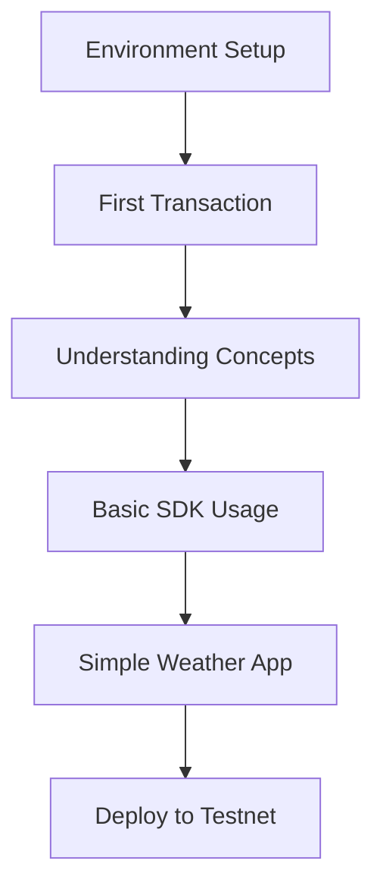
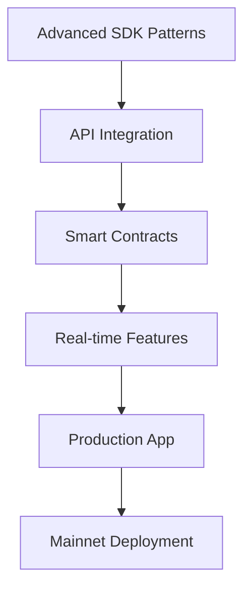
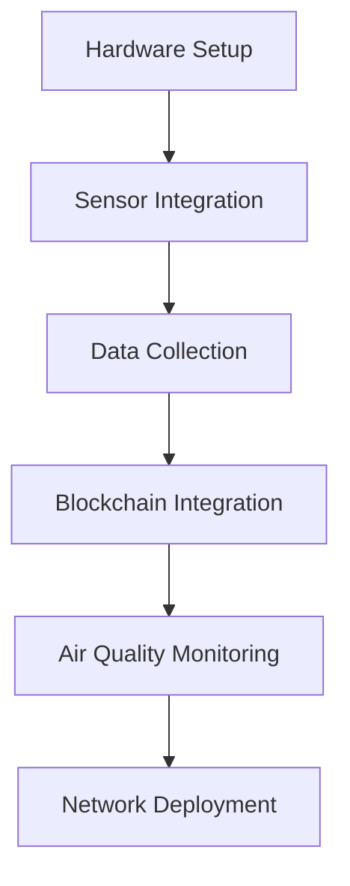
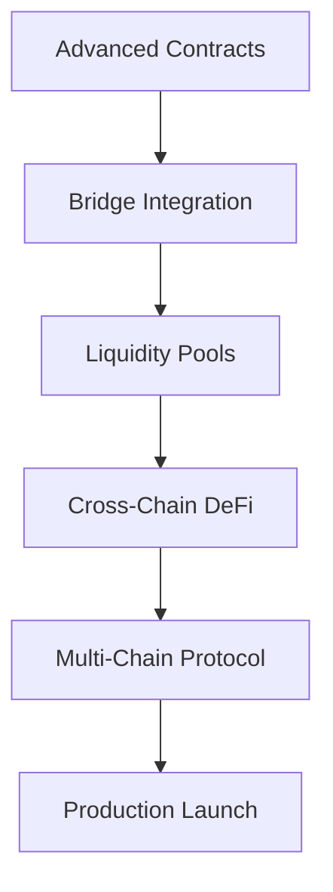
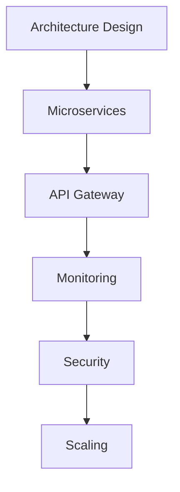

# WRFCoin Developer Learning Pathways

Choose your learning path based on your experience level and development goals. Each pathway
provides a structured progression through WRFCoin's comprehensive tutorial system.

## 🎯 Learning Paths Overview

### 1. **Beginner Path: Getting Started with WRFCoin**

_Perfect for developers new to blockchain and WRFCoin_

**Duration:** 2-3 weeks  
**Prerequisites:** Basic programming knowledge  
**Outcome:** Build your first WRFCoin application

**Pathway Steps:**

1. [Environment Setup](../getting-started/01-setup-environment.md) - 2 hours
2. [First Transaction](../getting-started/02-first-transaction.md) - 1 hour
3. [Understanding Concepts](../getting-started/03-understanding-concepts.md) - 3 hours
4. **Practice Project:** Build a basic weather data viewer
5. **Milestone:** Deploy your first application to testnet

---

### 2. **Intermediate Path: Full-Stack Development**

_For developers ready to build production applications_

**Duration:** 4-6 weeks  
**Prerequisites:** Completed beginner path or equivalent experience  
**Outcome:** Deploy a production-ready application with real-time features

**Pathway Steps:**

1. [JavaScript SDK Advanced](../intermediate/sdk-integration/01-javascript-sdk-advanced.md) - 4
   hours
2. [Python SDK Advanced](../intermediate/sdk-integration/02-python-sdk-advanced.md) - 4 hours
3. [REST API Integration](../intermediate/api-integration/01-rest-api-integration.md) - 6 hours
4. [GraphQL Integration](../intermediate/api-integration/02-graphql-integration.md) - 4 hours
5. [Smart Contract Interaction](../intermediate/smart-contracts/01-basic-contract-interaction.md) -
   3 hours
6. [Contract Deployment](../intermediate/smart-contracts/02-contract-deployment.md) - 5 hours
7. **Major Project:** Build a comprehensive climate monitoring dashboard
8. **Milestone:** Launch production application

---

### 3. **IoT Developer Path: Hardware Integration**

_Specialized path for IoT and hardware developers_

**Duration:** 3-4 weeks  
**Prerequisites:** Hardware experience, basic WRFCoin knowledge  
**Outcome:** Deploy autonomous weather station network

**Pathway Steps:**

1. [Weather Station Setup](../intermediate/iot-integration/01-weather-station-setup.md) - 8 hours
2. [Air Quality Monitoring](../intermediate/iot-integration/02-air-quality-monitoring.md) - 6 hours
3. **Hardware Project:** Build physical weather station
4. **Integration Project:** Connect to WRFCoin network
5. **Milestone:** Deploy autonomous monitoring network

---

### 4. **DeFi Developer Path: Cross-Chain Finance**

_Advanced path for DeFi and cross-chain development_

**Duration:** 6-8 weeks  
**Prerequisites:** Strong blockchain development experience  
**Outcome:** Build cross-chain DeFi protocols

**Pathway Steps:**

1. Complete Intermediate Path first
2. [Bridge Integration](../intermediate/cross-chain/01-bridge-integration.md) - 8 hours
3. **Advanced Project:** Build cross-chain yield farming protocol
4. **Security Project:** Implement multi-signature governance
5. **Milestone:** Launch multi-chain DeFi protocol

---

### 5. **Enterprise Path: Production Systems**

_For teams building enterprise-grade applications_

**Duration:** 8-12 weeks  
**Prerequisites:** Team development experience  
**Outcome:** Scalable production infrastructure

**Pathway Steps:**

1. Complete Full-Stack Development path
2. **Architecture Phase:** Design scalable system architecture
3. **Implementation Phase:** Build production infrastructure
4. **Security Phase:** Implement enterprise security
5. **Deployment Phase:** Deploy to production with monitoring
6. **Milestone:** Serve 1M+ requests per day

---

## 📚 Tutorial Reference Map

### **Getting Started** (Beginner)

- [Environment Setup](../getting-started/01-setup-environment.md)
- [First Transaction](../getting-started/02-first-transaction.md)
- [Understanding Concepts](../getting-started/03-understanding-concepts.md)

### **SDK Integration** (Intermediate)

- [JavaScript SDK Advanced](../intermediate/sdk-integration/01-javascript-sdk-advanced.md)
- [Python SDK Advanced](../intermediate/sdk-integration/02-python-sdk-advanced.md)

### **API Integration** (Intermediate)

- [REST API Integration](../intermediate/api-integration/01-rest-api-integration.md)
- [GraphQL Integration](../intermediate/api-integration/02-graphql-integration.md)

### **Smart Contracts** (Intermediate)

- [Contract Interaction](../intermediate/smart-contracts/01-basic-contract-interaction.md)
- [Contract Deployment](../intermediate/smart-contracts/02-contract-deployment.md)

### **IoT Integration** (Intermediate)

- [Weather Station Setup](../intermediate/iot-integration/01-weather-station-setup.md)
- [Air Quality Monitoring](../intermediate/iot-integration/02-air-quality-monitoring.md)

### **Cross-Chain** (Advanced)

- [Bridge Integration](../intermediate/cross-chain/01-bridge-integration.md)

---

## 🎯 Choose Your Path

### **I'm New to WRFCoin**

👈 Start with **[Beginner Path](#1-beginner-path-getting-started-with-wrfcoin)**

### **I Want to Build Web Applications**

👈 Follow **[Intermediate Path](#2-intermediate-path-full-stack-development)**

### **I'm Working with Hardware/IoT**

👈 Take **[IoT Developer Path](#3-iot-developer-path-hardware-integration)**

### **I'm Building DeFi Protocols**

👈 Pursue **[DeFi Developer Path](#4-defi-developer-path-cross-chain-finance)**

### **I'm on an Enterprise Team**

👈 Follow **[Enterprise Path](#5-enterprise-path-production-systems)**

---

## 💡 Tips for Success

### **Set Clear Goals**

- Define what you want to build before starting
- Break large projects into smaller milestones
- Document your progress and learnings

### **Join the Community**

- Participate in WRFCoin Discord/Forums
- Share your projects and get feedback
- Contribute to open source examples

### **Practice Regularly**

- Code along with tutorials
- Experiment with variations
- Build your own projects

### **Stay Updated**

- Follow WRFCoin development updates
- Review new tutorial releases
- Participate in community events

---

## 🔄 Continuous Learning

After completing your chosen path, consider:

- **Contributing**: Add tutorials or improve existing ones
- **Mentoring**: Help other developers getting started
- **Innovation**: Build novel applications using WRFCoin
- **Community**: Organize local meetups or workshops

---

## 📞 Need Help?

- **Documentation**: [https://docs.wrfcoin.network](https://docs.wrfcoin.network)
- **Discord**: [https://discord.gg/wrfcoin](https://discord.gg/wrfcoin)
- **GitHub**: [https://github.com/wrfcoin](https://github.com/wrfcoin)
- **Forum**: [https://forum.wrfcoin.network](https://forum.wrfcoin.network)

Choose your path and start building the future of climate-focused blockchain applications! 🌍
